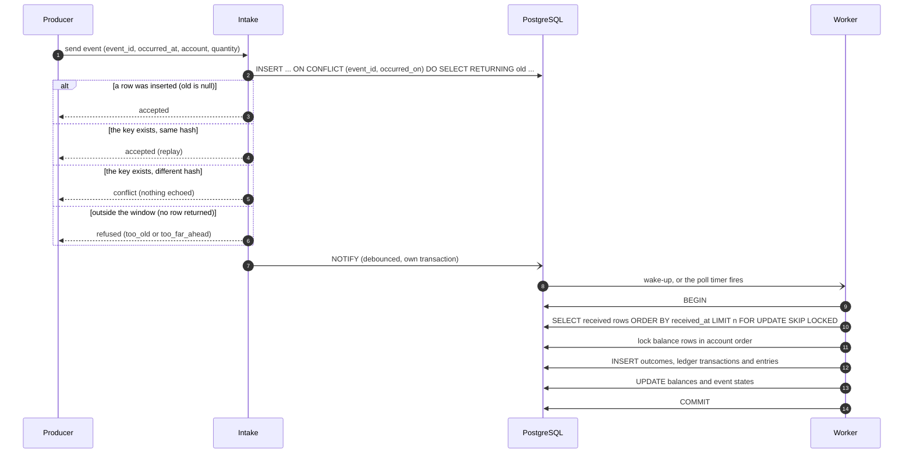
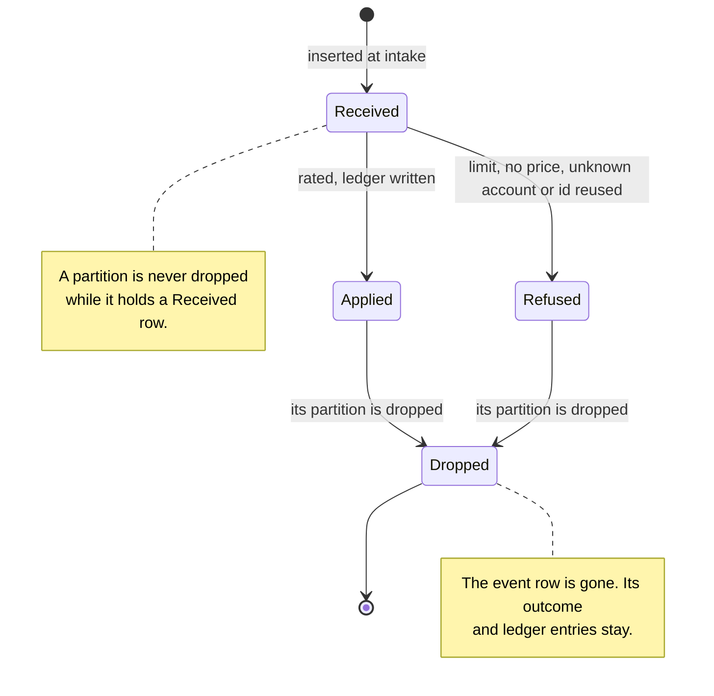

# 0001. PostgreSQL is the queue, the once-only record and the ledger

Status: **Accepted** (2026-11-27), the owner's decision

*Amended 2026-11-27:* PostgreSQL 19 is the minimum, by the owner's decision of that day. openbilling-rs uses its
features and keeps no workaround for older versions; the store refuses an older server when it connects. What changes
(the points below carry a marker where they are affected):

| # | Feature | What it changes | Source |
|---|---|---|---|
| A1 | `INSERT … ON CONFLICT … DO SELECT … RETURNING` (new in 19) | Intake is **one statement**: `INSERT … ON CONFLICT (event_id, occurred_on) DO SELECT RETURNING …` inserts the event or returns the row already there. It replaces `DO NOTHING` followed by a read (points 1, 2), and the two-statement fallback for older versions is dropped (point 5). `DO SELECT` needs a conflict target and a `RETURNING` clause; without a `FOR UPDATE/SHARE` clause it locks no row, so point 4 still holds | *Verified 2026-11-27*, PostgreSQL 19 documentation, `INSERT` (*ON CONFLICT Clause*), and release notes E.1.3.2 |
| A2 | `RETURNING OLD` / `NEW` (new in 18) | The same statement tells the answers apart, with no read: for an inserted row the `OLD` values are null; on the `DO SELECT` path they are the stored row (and `NEW` equals them). So `RETURNING` can give "inserted" (`old.event_id IS NULL`) and "same payload" (`old.payload_hash` compared with the hash sent) without returning the stored hash. An event outside the window is not proposed for insertion (point 8), so no row comes back. The exact statement, and how it names the bound an event failed, is written and fixed by tests with the code | *Verified 2026-11-27*, PostgreSQL 19 documentation, `INSERT` (*output_alias*, *output_expression*); PostgreSQL 18 release notes |
| A3 | `uuidv7()` (new in 18) | Ids the service makes (ledger transactions and entries, price book versions) default to `uuidv7()`: time-ordered (a Unix timestamp in milliseconds, a sub-millisecond part and random bits), so new keys land at the end of their index. Caller-given ids (events, credits) do not change. Such an id carries its creation time, which `uuid_extract_timestamp()` reads: it is not a secret | *Verified 2026-11-27*, PostgreSQL 19 documentation, 9.15 *UUID Functions*; PostgreSQL 18 release notes |
| A4 | Temporal `WITHOUT OVERLAPS` keys (new in 18) | **Considered, not adopted** for price book versions. A version has only a `valid_from`, never changes once published (point 18), and its end is known only when the next one is published. A range column would have to be changed when the next version comes, or be left open and overlap it. A temporal key also needs the `btree_gist` extension for its non-range parts. The version in effect at a time stays the one with the greatest `valid_from` not after it, under a plain `UNIQUE (price book, valid_from)`. Revisit if versions ever get an end of their own | *Verified 2026-11-27*, PostgreSQL 19 documentation, 5.7 *Temporal Tables* |
| A5 | `NOTIFY` wakes only listening backends (new in 19) | Lowers the cost of the wake-up of points 16 and 17; nothing else changes. The commit-time lock named under *Consequences* stays *unverified*: the 19 `NOTIFY` page does not mention it | *Verified 2026-11-27*, PostgreSQL 19 release notes E.1.3.1.2 and documentation, `NOTIFY` |

Nothing else found in 18 or 19 removes a workaround here. A unique key on a partitioned table must still include every
partition key column (point 7), and `DETACH PARTITION … CONCURRENTLY` still takes `SHARE UPDATE EXCLUSIVE` on the
parent (point 10) (*verified 2026-11-27*, PostgreSQL 19 documentation, 5.13 *Table Partitioning*). The sequence diagram
below is updated to A1.

*Amended 2026-11-27 (the ledger, slice 2):* what building the ledger changed. Each point named below carries a marker.

| # | Change | Points |
|---|---|---|
| B1 | **Amounts are integer micro-units** of a currency (10^-6 of its major unit), not its minor unit: one usage event is often worth less than one minor unit. An `i64` still holds about 9.2 × 10^12 major units. Each account carries its own currency, the operator names the set of currencies, and nothing converts between them. A decision for the owner to confirm | 20 |
| B2 | **An owner holds several accounts**, one per currency and label, and the balance row an event locks is the owner's in that currency ([ADR 0002](0002-an-owner-holds-several-accounts.md)). Locks are taken in (owner, currency) order | 13, 22 |
| B3 | **Every rule is SQL** in the migrations of `openbilling-pg`; the Rust store only calls it ([ADR 0002](0002-an-owner-holds-several-accounts.md), *Where the rules live*) | 1, 11 to 15 |
| B4 | **This slice takes pre-priced events**: an event carries its owner, currency, member and amount, and no meter or quantity. Rating against a price book, the meter, the quantity and the price book version on the outcome come with the next slice | 1, 3, 12, 14, 18 |
| B5 | **The balance row is updated once per event, not once per batch**: each event's draw depends on what the one before it left. Updating once per batch is left open, with the busy-account question below | 22 |
| B6 | **The limit is a debt limit** per owner and currency, none by default: a debit is refused `limit` when the debt it leaves would pass it, or would pass the largest amount | 23 |
| B7 | **The drain claims an event id before it takes any balance lock**: it inserts the id's outcome as `pending`, in id order, then locks balances in (owner, currency) order, then decides. A drain waiting on an id holds no balance lock, so drains cannot deadlock on a reused id. A constraint trigger refuses a commit that leaves an outcome pending | 13, 14, 15 |
| B8 | **Detaching and dropping old partitions is not built yet**; creating them ahead is (`ob_prepare_partitions`) | 10 |

*Amended 2026-11-27 (the price book, slice 3):* [ADR 0004](0004-a-versioned-price-book-in-sql.md) builds rating.
What it changes here:

| # | Change | Points |
|---|---|---|
| C1 | **Raw events are rated at intake**, not by the worker: intake prices each by the version in force at its occurrence time, refuses an unpriced one (`unpriced_meter`, `unpriced_dimension`), and stores its amount and version; the drain is unchanged. `no_price` stays a reserved outcome reason that no drain decides | 12, 14, 27 |
| C2 | **The payload hash of a raw event changes**: it covers the meter, the quantity and the dimensions, and not the amount. A pre-priced event (B4) keeps its hash; pre-priced intake stays, for a producer that rates elsewhere | 3 |
| C3 | **No back-dating is made exact**: a version takes effect after the clock *and* after every event already rated, since an event may occur up to the skew ahead of the clock. A load and a rating intake exclude each other by a table lock | 19 |
| C4 | **Rounding**: once per event, to the micro-unit, half to even, of `quantity × price ÷ per` in `numeric` (the recommendation of *Still open*, built) | 20 |

## Summary

A usage event is written once, by one insert, into a table partitioned by day. That table is the queue and the
once-only record at the same time: a replay hits the unique key and changes nothing. Workers drain it with
`FOR UPDATE SKIP LOCKED` and, in one transaction per batch, rate the events, write the double-entry ledger, update the
balances and mark the events done. `LISTEN/NOTIFY` wakes them; the table is the truth. Old partitions are dropped
whole, and an event older than the window is refused at intake, so once-only stays exact.

The scope is rating and the ledger. Invoicing, payment and tax are not part of this decision.

## Context

A usage billing service has three jobs. It takes events from producers. It turns them into amounts with a price book.
It records the amounts so a balance and a statement can be trusted.

Producers deliver at least once. A network error leaves them unsure, so they retry, and the service must count each
event once. The same holds for credits.

Two shapes are common. One puts a broker in front of a database and keeps a separate table of the ids it has
applied. The other writes the event and the debit in the same request. The first has two stores that must agree,
and an id can be in one and not the other. The second makes intake as slow as the slowest balance row, and a busy
account stalls its producer.

The owner's decision (2026-11-27): the billing service uses PostgreSQL queues, "to make writes easy and atomic".
PostgreSQL is already the only infrastructure (rule 1 of the agent guide). This record says how.

## Decision

### Intake

1. **Intake is one insert.** An event carries a caller-given `event_id`, an account, a meter, an integer quantity and
   its occurrence time (`occurred_at`, UTC). Intake writes it into `usage_event` with
   `INSERT … ON CONFLICT (event_id, occurred_on) DO NOTHING`. Nothing else is written, and no other table is read.
   *Amended 2026-11-27 (A1): `DO SELECT … RETURNING`, one statement.*
2. **A replay is a no-op, and says so.** When the insert adds no row, intake reads the stored row's `payload_hash` by
   its key (*amended 2026-11-27 (A2): the same statement returns it, no read*):
   - the same hash is a replay, answered exactly as the first acceptance was;
   - a different hash is a **conflict**, answered as a conflict with the event id only. The answer never echoes the
     stored payload, its hash or any field of it.
3. *(Amended 2026-11-27 (C2): for a raw event, the meter, quantity and dimensions, not the amount.)* **The payload
   hash** is SHA-256 over a canonical form of the fields that define the event (account, meter,
   quantity, occurrence time, dimensions): keys sorted, no insignificant whitespace, times in UTC with a fixed
   precision. Fields the service adds (intake time, producer identity) are not in it. The exact canonical form is
   specified with the code and fixed by test vectors.
4. **Intake takes no row lock a worker holds.** `DO NOTHING` does not lock the existing row (only `DO UPDATE` and
   `DO SELECT … FOR UPDATE/SHARE` do; *verified 2026-11-27*, PostgreSQL 19 documentation, `INSERT`). A worker that holds
   the row `FOR UPDATE` therefore never blocks a replay. A concurrency test proves this before the first release.
5. **On PostgreSQL 19 or later**, `ON CONFLICT … DO SELECT RETURNING payload_hash`, without a `FOR` clause, does the
   insert-or-read in one statement (*verified 2026-11-27*, PostgreSQL 19 documentation, `INSERT`). On older versions it
   is two statements. Both give the same answers. *Amended 2026-11-27 (A1): 19 is the minimum, so it is always the one
   statement; there is no two-statement form.*

### The queue is the dedupe table

6. **No separate table of applied ids.** The unique key of `usage_event` is the once-only record for the window.
7. **Partitioned by the day of occurrence, not of intake.** `usage_event` is `PARTITION BY RANGE (occurred_on)`, one
   partition per UTC day, and its primary key is `(event_id, occurred_on)`. `occurred_on` is a plain column, held to
   `occurred_at` by a `CHECK`.

   *Why not the intake day:* PostgreSQL allows a unique key on a partitioned table only if it includes every
   partition key column (*verified 2026-11-27*, PostgreSQL 19 documentation, *Table Partitioning*, *Limitations*).
   Keyed on the intake day, a replay received on a later day lands in another partition and is not seen. The
   occurrence time is part of the payload, so a true replay always lands in the same partition. The design as first
   stated said "the intake time"; this is the one change, and the reason is that limit.
8. **The window is the partition retention.** It is configurable; the default is **7 days**. Intake accepts an event
   only if `occurred_at` is no earlier than the start of the UTC day `W − 1` days ago and no later than `now()` plus a
   skew allowance (default 5 minutes). Anything else is refused at intake (`too_old`, `too_far_ahead`), and no row is
   written. The bound is checked against the database's clock, in the insert statement itself, so no application
   clock decides it.
9. **Exact once-only follows.** A replay of an event can only arrive while intake still accepts its day, and a day's
   partition is kept at least that long. So no replay can arrive after its record is gone.
10. **Cleanup is `DETACH` and `DROP`, never `DELETE`.** A maintenance job creates partitions ahead (default: two days)
    and removes a day's partition when both hold:
    - intake has refused every event of that day for at least one full day (the grace day absorbs a statement that
      started before midnight and any drift between clocks);
    - the partition holds no unapplied row.

    It uses `DETACH PARTITION … CONCURRENTLY`, which takes `SHARE UPDATE EXCLUSIVE` on the parent rather than
    `ACCESS EXCLUSIVE` (*verified 2026-11-27*, PostgreSQL 19 documentation, *Partition Maintenance*), then drops the
    detached table. There is **no default partition**. An insert for a day with no partition is answered
    "unavailable" and raises an alert; it means the maintenance job is behind.

### Workers

11. **Workers drain with `SKIP LOCKED`.** A worker takes a batch:
    `SELECT … FROM usage_event WHERE state = 'received' ORDER BY received_at LIMIT n FOR UPDATE SKIP LOCKED`,
    served by a partial index on `received_at` where `state = 'received'`.
12. **One transaction per batch.** *(Amended 2026-11-27 (C1): intake rates, the worker does not.)* In it the worker
    rates each event, writes its outcome and ledger entries, updates
    the balances and sets each event's `state` to `applied` or `refused`. Two workers never take the same row. A
    crash rolls the whole batch back and the rows are taken again. A slow batch holds locks only on its own rows and
    on balance rows, never on anything intake touches.
13. **Lock order prevents deadlocks.** The worker locks the balance rows of a batch `FOR UPDATE` in one order (account,
    then currency) before writing any entry. *Amended 2026-11-27 (B2, B7): (owner, currency), after the event ids are
    claimed in id order.* It runs at `READ COMMITTED`; the explicit locks, not the isolation level,
    serialize debits of one account. Concurrency tests prove that two workers neither double-apply nor deadlock.
14. **Every event gets a durable outcome.** The worker inserts one row per event into `event_outcome`, keyed by
    `event_id` alone (not partitioned by day, kept for good): applied or refused, the reason, the price book version,
    the amount and the ledger transaction. The ledger transaction also carries `event_id` under a `UNIQUE`
    constraint. Both are defence in depth: if an id was somehow taken twice, the second insert fails and the batch
    rolls back.
15. **The same id on two occurrence days** is not caught at intake, since the two rows live in different partitions.
    It is caught here: the second event finds an outcome for its id, is refused as `id_reused` and moves no money.
    That refusal is kept on its event row until the partition is dropped, and counted. The first one applied wins.

### Wake-up

16. **`LISTEN/NOTIFY` wakes workers; a poll is the backstop.** Each worker keeps one dedicated `LISTEN` connection and
    polls every few seconds anyway. A notification carries no event data: notifications are delivered only on
    commit, and the payload must be shorter than 8000 bytes (*verified 2026-11-27*, PostgreSQL 19 documentation,
    `NOTIFY`). A lost notification costs at most one poll interval.
17. **Intake sends `NOTIFY` outside the insert's transaction,** debounced to at most one per short interval per
    process, after a commit. The insert stays one statement in its own transaction. This keeps intake's commits free
    of whatever cost a `NOTIFY` adds at commit (see *Consequences*).

### Rating

18. **A versioned price book.** A version has an id (*amended 2026-11-27 (A3): `uuidv7()`*), a `valid_from` time and
    its prices. Once published, a version
    never changes. An event is rated by the version in effect at its `occurred_at`, and that version id is stored on
    its outcome, so a statement can be derived again from the outcomes alone.
19. **No back-dating.** *(Amended 2026-11-27 (C3): and after every event already rated.)* A new version takes effect at or after the time it is published. Otherwise an event still in
    the queue would be rated by a version that applied events never saw. A correction to the past is a credit.
20. **Integers only.** Quantities are integers. Amounts are integers in the minor unit of a currency. No float is used
    anywhere, in the database or in the code (rule 3). *Amended 2026-11-27 (B1): micro-units of a currency, not its
    minor unit.*

### Ledger

21. **Double-entry.** A ledger transaction has two or more entries, and its entries sum to zero per currency. A
    deferred constraint trigger checks the sum at commit, so a transaction that does not balance cannot commit.
22. **Balances are maintained in the same transaction** for accounts that carry a limit: one row per account and
    currency. A worker updates each balance row once per batch, with the sum of that batch's entries for it.
    *Amended 2026-11-27 (B2, B5): one row per owner and currency, updated once per event.*
23. **Limits are checked there** (*amended 2026-11-27 (B6): a debt limit*). The worker checks each debit, in the batch's order, against the locked balance and
    its limit. A debit past the limit is **refused, not lost**: its outcome is `refused`, reason `limit`, with the
    amount it would have been. A refusal is final for that event.
24. **Counter-accounts carry no live balance row.** Every debit has a balancing credit, for instance to a revenue
    account per currency. If that account had a balance row, every event of every account would lock it. Its balance
    is the sum of its entries, read on demand or rolled up by a job.
25. **Credits are once-only by a caller-given id,** under a `UNIQUE` constraint, kept for good. The same id with a
    different payload is a conflict, answered as at intake. Credits are written directly, not queued: they are rare,
    and the caller wants the new balance in the answer.

### Observability and back-pressure

26. **The lag is the age of the oldest unapplied event**: `now() − min(received_at)` over `state = 'received'`, served
    by the partial index of point 11. It is the one number that says whether billing keeps up.
27. **Also measured:** intake rate (accepted, replays, conflicts), intake refusals by reason (`too_old`,
    `too_far_ahead`, invalid), worker outcomes by reason (`limit`, `no_price`, `unknown_account`, `id_reused`),
    batch size and duration, and the partitions that exist ahead and are waiting to be dropped.
28. **Intake never waits on workers.** When the lag passes a threshold, the service reports it: in its metrics, in its
    status answer and in its log. **Readiness stays up.** The queue is the part that absorbs a burst. Taking intake
    out of rotation would turn a lag into lost or piling-up retries at every producer, and it would not help the
    workers catch up. Readiness fails only when the service cannot write to PostgreSQL.
29. **A lag close to the window is an alarm.** A partition with unapplied rows is never dropped (point 10), so no
    event is lost. But intake refuses events for days that fall out of the window, whatever the lag.

### How the design sits on CrateStack

The implementation stack is CrateStack (schema-first, PostgreSQL) with Authkestra for identity. What was checked in
the pinned skills (CrateStack 0.20.6):

| Need | What CrateStack offers | So |
|---|---|---|
| A table partitioned by day | A model takes only `@@allow` `@@deny` `@@emit` `@@paged` `@@audit` `@@soft_delete` `@@retain` `@@subscribe` `@@id` `@@unique` `@@index` `@@internal` `@@rename` `@@map` (and `@@mcp`); nothing for partitioning. *Verified 2026-11-27, `cratestack-schema/SKILL.md`.* A composite `@@id([…])` is rejected by every entry macro. *Verified 2026-11-27, `cratestack-data-integrity/SKILL.md`.* | `usage_event` (composite key, partitioned) is **hand-written SQL**, not a model |
| Hand-written DDL beside generated migrations | `migrate diff` works from a snapshot of the schema's projections only; tables it does not project (its own bookkeeping) are never altered. The applier runs `up.pre.sql` then `up.sql` through the simple-query protocol, one transaction per migration, and `migrations_from_dir` loads an embedded tree. *Verified 2026-11-27, `cratestack-migrations/SKILL.md`.* | Tables no model names are left alone by `migrate diff`: *unverified* (inferred). That the applier accepts a migration directory `migrate diff` did not write: *unverified*. Both are checked first |
| `ON CONFLICT DO NOTHING` | `.upsert(..).do_nothing()`, server-only, for a model whose `@id` is client-supplied; on an existing row it returns `CratestackError::Conflict`. *Verified 2026-11-27, `cratestack-data-integrity/SKILL.md`.* | Not usable for events (not a model, and the hash must be compared). A candidate for credits: *unverified* that it fits |
| `FOR UPDATE SKIP LOCKED` | No generated API for it in the skills. CrateStack's own outbox drain uses it internally. The runtime exposes `db.pool()` and `db.transaction(\|tx\| …)` for raw SQL. *Verified 2026-11-27, `cratestack-server/SKILL.md`.* | The drain is **raw SQL** through those handles |
| `LISTEN/NOTIFY` | The default subscription backplane, `PgNotifyBackplane`, uses `LISTEN/NOTIFY`; `LISTEN` does not work behind PgBouncer in transaction mode. *Verified 2026-11-27, `cratestack-rpc/SKILL.md`.* | Workers need a direct session. Whether the wake-up goes through the backplane or a plain listener is left to the implementation |
| Retention | `@@retain(days: N)` parses and is never acted on. *Verified 2026-11-27, `cratestack-data-integrity/SKILL.md`.* | The partition job is ours (point 10) |
| Amounts | `BigInt` is a 64-bit integer type, sent as a decimal string on JSON and CBOR. *Verified 2026-11-27, `cratestack-schema/SKILL.md`.* | Amounts and quantities are `BigInt` where they cross the API |
| Reads | A `query` block is raw PostgreSQL SQL with typed parameters and a `type` result. *Verified 2026-11-27, `cratestack-schema/SKILL.md`.* | Balances and statements can be `query` blocks over the hand-written tables |
| A missing partition | Error class `23514`; on 0.20.6 only `db_sqlstate()` and `db_constraint()` exist, the table and column accessors come later. *Verified 2026-11-27, `cratestack-troubleshooting/SKILL.md`.* | Intake maps it to "unavailable" by SQLSTATE, never by message text |
| HTTP replay | An `IdempotencyLayer` replays a response by `Idempotency-Key`. *Verified 2026-11-27, `cratestack-data-integrity/SKILL.md`.* | It may sit in front, but it is not the once-only record; the tables are |

Identity (who may send events, who may read an account) uses Authkestra and is decided in a later record.

## Diagrams

An event refused at intake (outside the window, or invalid) never gets a row, so it has no state here. A crash
returns a batch's rows to `Received`, because the transaction that would have moved them rolls back.

## Consequences

**Good**

- One store. The once-only record and the queue cannot disagree, because they are the same row.
- A write is one insert. A producer retries freely, and a replay costs one index probe.
- Every effect of an event (outcome, ledger, balance, state) commits or rolls back together.
- Workers scale out without coordination. Intake and workers do not block each other.
- Retention is a metadata operation. Dropping a day leaves no dead rows and starts no vacuum storm.
- A statement can be derived again from the outcomes and the price book versions they name.

**Bad, or to be managed**

- **Exactly-once holds only within the window.** It is exactly-once *in effect*, for replays that arrive while their
  day is accepted. A producer that retries after the window is refused, not deduplicated; its buffer must be shorter
  than the window. A longer window costs more partitions and index.
- **The same id on two occurrence days** is answered "accepted" twice and refused later at apply time (point 15). A
  producer learns of it only from the outcome, not from intake.
- **A partition per day needs a maintenance job.** If it stops, intake fails once the days run out (no default
  partition, by design), and dropping stops. It is monitored like a worker.
- **Late events land in old partitions,** so the drain spans every live partition. With the default window that is
  about ten partitions, each with a small partial index.
- **Marking an event done is an `UPDATE`,** so live partitions carry dead rows until autovacuum. The window bounds it.
- **`NOTIFY` has limits.** The payload must be under 8000 bytes; notifications arrive only on commit; a full queue
  fails the committing transaction (*verified 2026-11-27*, PostgreSQL 19 documentation, `NOTIFY`). Committing a
  transaction that issued `NOTIFY` is also reported to take a database-wide lock, which serializes such commits
  (*unverified*). Points 16 and 17 keep it out of the insert's transaction and out of the truth.
- **`LISTEN` needs a direct session,** not a pooler in transaction mode.
- **Hot rows.** An account with heavy traffic serializes its debits on its balance row. Updating each row once per
  batch (point 22) and keeping counter-accounts off the hot path (point 24) remove most of it. Whether a single very
  busy account needs more is open (below).
- **Apply order is only roughly intake order.** Several workers and `SKIP LOCKED` mean which of two debits meets a
  limit first is not strictly the order they arrived in.
- **Usage refused for a limit is not billed.** The record keeps it; what to do with it is the operator's choice.
- **Hand-written SQL beside a schema-first framework.** The event table, the drain and the partition job are outside
  what CrateStack generates and checks. They need their own tests against a real PostgreSQL.

## Alternatives rejected

| Alternative | Why not |
|---|---|
| A broker (Kafka, NATS) in front of PostgreSQL | A second piece of infrastructure, against rule 1. Its offsets and the ledger commit separately, so once-only needs a dedupe table in PostgreSQL anyway: two stores that must agree |
| Redis streams | The same split, and the stream is not durable in the way a ledger needs. A cache in the write path, against rule 1 |
| The pgmq extension | Not on every managed PostgreSQL (*unverified* per provider). Its queue is a separate table, so the event table would be a second dedupe store beside it |
| A queue table drained by `DELETE` | Every applied event becomes a dead row, so vacuum works constantly on the hottest table. The deleted row is also the once-only record, so the record would vanish at once |
| Debiting synchronously at intake | Intake would wait on balance row locks. A busy account would slow its producers, and a debit failure would fail the intake, which invites retries |

## Still open

| Question | Recommendation |
|---|---|
| Is an event id unique per deployment or per producer? | Per producer: key `(producer, event_id, occurred_on)`, so a conflict never tells one producer about another's ids |
| Does one very busy account need more than one balance update per batch? | Measure first. If it does, split its balance into a few sub-rows with a share of the limit each, or a per-day aggregate rolled up; both make the limit check harder. Undecided |
| ~~Minimum PostgreSQL version~~ | ~~The oldest version upstream still supports at the first release. Use `DO SELECT` where available (19), two statements elsewhere~~ **Decided 2026-11-27: PostgreSQL 19** (the amendment at the top) |
| ~~A price below one minor unit per unit~~ | ~~Prices as an integer amount per an integer quantity; round once per event, half-to-even, with the rounding mode stored on the version~~ **Built 2026-11-27** ([ADR 0004](0004-a-versioned-price-book-in-sql.md)): micro-units per an integer `per`, half to even once per event. The mode is one for every version, not stored on each |
| How long are outcomes and the ledger kept, and how are they stored? | Kept for good; partition them by month for archival, never drop them in the service |
| Can a refused debit be retried after a credit? | No. A refusal is final for its event; an operator who wants it billed sends a new event with a new id |
| Window and skew defaults | 7 days and 5 minutes, both configurable; the window never shorter than the producers' retry horizon |
| Per-producer intake rate limits | Yes, at intake, but in a later record together with identity |
