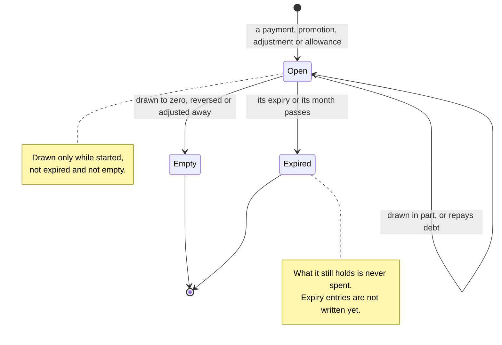

# 0002. An owner holds several accounts

Status: **Accepted** (2026-11-27), the owner's decisions of that day

## Summary

An **owner** is the external subject that pays: for example the `sub` an identity provider gives. It holds several
**accounts**, each with exactly one currency and one label, such as `main` or `promo`. A usage event names the owner
and the currency. The debit draws that owner's accounts in that currency in a configured order of labels, and within
each account its lots in a configured order of lot kinds. What finds no credit is the owner's debt.

Credit comes from one of three **sources**: a payment, a promotion or an adjustment. Each is once-only by its id. Only
a payment can be refunded or charged back, and never by more than it was.

Every rule of the ledger is SQL, in PostgreSQL. The Rust store calls it and maps what it raises.

## Context

ADR 0001 made PostgreSQL the queue and the ledger, with one balance per account. Three needs did not fit one account
per payer:

- A payer often holds money in more than one currency. The ledger never converts, so each currency needs its own
  balance.
- Promotional credit is often kept apart from paid credit: shown apart, spent first, expiring on its own.
- Not every credit is a payment. An operator corrects mistakes, and a promotion has no payment behind it. A refund cap
  only makes sense for a payment.

The owner also decided (2026-11-27) that whatever SQL can do, SQL does: constraints, functions, views. PostgreSQL then
holds both the data and the rules that keep it right, and a second implementation can never drift from the first.

## Decision

### Owners and accounts

1. **An owner is an opaque subject**, 1 to 255 bytes of printable ASCII: an OpenID Connect `sub` fits.
2. **An account is an owner's, in one currency, with one label.** `(owner, currency, label)` is unique. An account has
   an opaque id given by whoever opens it, so opening it is once-only: the same id with the same terms is a replay,
   with other terms a conflict.
3. **The operator names the currencies and the labels.** An account in a currency or with a label not configured is
   refused. A new configuration may add to them but never leave one out, since accounts may name it.
4. **Amounts are micro-units of the account's currency** (ADR 0001, amended 2026-11-27, B1). Nothing converts between
   currencies; an amount is only added to amounts of the same currency.
5. **One balance row per owner and currency** holds the debt and an optional debt limit. Every write of that owner's
   money in that currency locks it first. This is the lock of ADR 0001, point 13, now keyed by (owner, currency).

### Credit sources

6. **A credit has a source**, a closed set:

   | Source | Keyed by | Amount | Opens |
   |---|---|---|---|
   | `payment` | the external payment id | positive | a `payment` lot |
   | `promotion` | a caller-given grant id | positive, usually with an expiry | a `promotion` lot |
   | `adjustment` | a caller-given id | positive or negative, never zero | positive: an `adjustment` lot. Negative: takes credit from the account's lots in lot order; what they lack is debt |

7. **Once-only by (source, id).** The same id again with the same account, amount and expiry is a replay and answers
   the first booking. With anything else it is a conflict, never a second credit. An id is once-only within its
   source: a promotion may use an id a payment uses.
8. **A credit names its account by id, or by owner, currency and label.** Both routes reach the same once-only key.
9. **Only payments can be reversed.** A refund or a chargeback is once-only by its kind and its own id, names its
   payment, and takes back a positive amount. Refunds and chargebacks of one payment, together, never take back more
   than the payment. What the payment's lot no longer holds becomes debt.
10. **New credit repays debt first.** A new lot that can be spent now repays the owner's debt in its currency before
    anything else draws it.
11. **The allowance** is a lot of its own kind: granted once per account and calendar month (UTC), spendable during
    that month only.

### The draw

12. **The debit draws across the owner's accounts in the currency, by label rank**: the first configured label first.
    Within an account it draws the lots that can be spent now (started, not expired, not empty) by **lot kind rank**,
    then, for a kind configured *soonest expiry first*, by expiry with no expiry last, then oldest first. The example
    configuration: labels `promo` then `main`; lots `allowance`, then `promotion` by expiry, then `adjustment` and
    `payment` oldest first.
13. **What finds no credit is debt**, unless it would pass the owner's debt limit in the currency, or the largest
    amount: then the event is refused `limit` and moves nothing. *Amended 2026-11-27, the owner's decision "Always
    book as debt" (ADR 0001, amended, E1 to E3): what finds no credit is debt whatever the limit; only a debt past
    the largest amount is refused, as `overflow`. The limit refuses new calls (`allowed` answers `debt_limit`) and
    flags the owner (`ob_past_debt_limit`).*
14. **A member cap** applies per owner, currency, member and calendar month (UTC). It is a read for whoever serves the
    usage (`allowed`), not a refusal of the debit: the usage already happened. *(Amended 2026-11-27: the debt limit
    now works the same way, point 13.)*

### Where the rules live

15. **Every rule is SQL.** The debit, each credit source, the reversal cap, the drain, the draw order, intake's
    checks, the payload hash and the reads are functions, constraints and triggers in the migrations of
    `openbilling-pg`. The Rust store calls one function per operation and maps the answer. Rust keeps the port, the
    types, the wiring and the tests, and does not implement a rule a second time.
16. **Plain SQL gets a SQL-standard body**: `LANGUAGE sql` with `RETURN …` or `BEGIN ATOMIC … END`. Such a body is
    parsed when the function is created and records what it depends on, so a table it uses cannot be dropped or
    renamed under it; it cannot take polymorphic argument types (*verified 2026-11-27*, PostgreSQL 19 documentation,
    CREATE FUNCTION, *sql_body*). The draw, the debt, the debt repayment, the reads and the helpers are written so.
17. **`LANGUAGE plpgsql` where SQL cannot say it**: control flow, a loop whose steps see each other's writes, or
    `RAISE` with a SQLSTATE. The intake, the drain, each credit, the reversal, the allowance, the configuration, the
    account functions and the trigger functions are written so, and each says why in its comment.
18. **Functions, not procedures**, because callers need rows back: a procedure returns no function value, only its
    output parameters, and is called alone with `CALL` (*verified 2026-11-27*, PostgreSQL 19 documentation, 36.4
    *User-Defined Procedures*).
19. **Atomicity comes from the caller's transaction**, not from `BEGIN ATOMIC`. A function runs inside the
    transaction of the statement that calls it and cannot commit or roll back on its own (*verified 2026-11-27*,
    PostgreSQL 19 documentation, 36.4). The store calls each function in a statement of its own, so each call commits
    or rolls back whole.
20. **One map of SQLSTATEs.** The functions raise SQLSTATEs of class `OB`, five upper-case letters and digits, which
    PL/pgSQL allows for any code but `00000` (*verified 2026-11-27*, PostgreSQL 19 documentation, 41.9 *Errors and
    Messages*). The first two characters are the class (Appendix A); `OB` is in no class the standard defines. One
    table in `openbilling-pg` maps each code to a refusal and its class, and a test holds the table and the
    migrations to the same codes. A refusal of a batch names its events in the error's DETAIL.
21. **Migrations are sent whole.** sqlx sends a migration file as one simple-protocol query, so no `BEGIN ATOMIC` body
    is split on its semicolons (*verified 2026-11-27*, sqlx-postgres 0.9.0 source).

## Diagrams

```mermaid
sequenceDiagram
    autonumber
    participant W as Drain
    participant DB as PostgreSQL
    W->>DB: SELECT * FROM ob_drain(n)
    Note over DB: one transaction
    DB->>DB: take received events, FOR UPDATE SKIP LOCKED
    DB->>DB: claim each event id: outcome pending, in id order
    DB->>DB: lock balance rows in (owner, currency) order
    loop each claimed event, owner by owner
        alt no account in its currency
            DB->>DB: outcome refused, unknown_account
        else the debt would pass the largest amount
            DB->>DB: outcome refused, overflow
        else
            DB->>DB: draw accounts by label rank, lots by kind rank, expiry, age
            DB->>DB: the rest is debt; revenue gets the whole amount
            DB->>DB: outcome applied
        end
    end
    DB->>DB: event rows take their outcome's state
    DB-->>W: one row per event taken
```



A lot opens when credit comes in. The debit and a negative adjustment draw it; a refund draws its payment's lot. It
leaves the draw when it is empty or expired, and it is never deleted: the ledger is append-only, and a lot's remainder
is the sum of its entries.

## Consequences

**Good**

- A payer holds money in several currencies, and promotional credit apart from paid credit, with one rule for both.
- Credit is once-only by its source and id, whichever route names the account.
- The reversal cap is a database fact: a trigger checks it on every reversal, whoever writes the row.
- One implementation of each rule. A second store would be a second database, not a second rulebook.
- A rule that a migration changes is checked by PostgreSQL when the migration runs: a function's body is parsed then.

**Bad, or to be managed**

- **The rules are PL/pgSQL and SQL**, which fewer contributors read than Rust, and which only a real PostgreSQL 19
  can test. The conformance suite runs only where a database is given.
- **An owner's accounts in one currency share one lock**, so an owner with heavy usage serializes it, as ADR 0001's
  account did.
- **A label's rank is global**: every owner's accounts are drawn in the same label order.
- **A promotion may reuse a payment's id** (ids are once-only within a source). A caller that wants one namespace
  must keep it.
- **The member cap is not enforced by the ledger.** It is a read; whoever serves the usage must ask.

## Alternatives rejected

| Alternative | Why not |
|---|---|
| One account per owner holding every currency | Every balance, limit and statement would need a currency key, and promotional credit could not be kept apart |
| Promotional credit as a flag on a lot, not an account | Shown and limited apart only by special cases in every read; a label does it with the same rule as any account |
| The rules in Rust over plain tables | Two places would hold the truth: the code and whatever else writes the tables. The owner chose SQL |
| Procedures (`CALL`) | They return no rows, and the drain must answer one row per event |
| A cap on every credit source | Only a payment has an amount the outside world can take back |

## Still open

| Question | Recommendation |
|---|---|
| Should an owner's debt limit apply per currency or across currencies? | Per currency, as built: currencies are never added up |
| Is the label order the same for every owner? | Yes for now; a per-owner order would need its own table |
| Can a negative adjustment draw from the owner's other accounts? | No, as built: an adjustment corrects one account |
| Should a reversal arriving before its payment wait or be refused? | Refused (`unknown_payment`), as built; the caller retries |
| Expiry entries for what an expired lot still holds | Write them in a later slice, so revenue and breakage can be read from the ledger |
