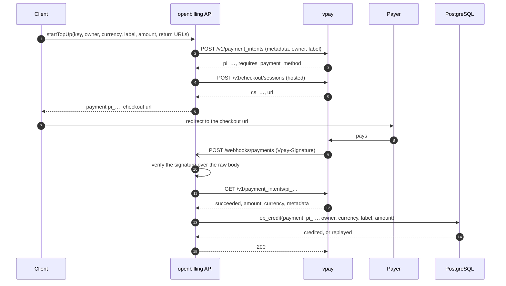
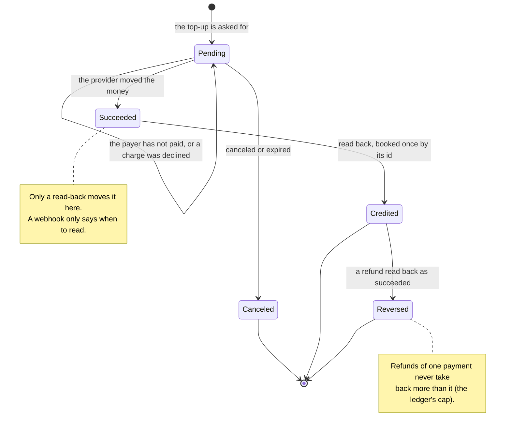

# 0003. Credits come from a payment provider through a port; the external API is CrateStack

Status: **Proposed** (2026-11-27). The owner's decisions quoted under *Context* stand; the rest is for the owner to
confirm.

## Summary

openbilling never touches card or wallet data. To take money it asks a **payment provider**, through a port, for a
payment (a **top-up**), and sends the payer to the provider's checkout. It books a `payment` credit only when the
provider, **read back**, says the payment succeeded; a webhook is a hint that names what to read again. The credit is
once-only by the provider's payment id, through the ledger's existing credit function. A refund the provider says it
paid back becomes a reversal, which the ledger caps at the payment. **vpay** is the first adapter.

Promotions and adjustments are not payments: they come from the operator, through the API.

The **external API is CrateStack**: on-demand queries over the ledger's tables, custom selects as `query` blocks,
policies on every read and write, and mutation procedures whose Rust bodies call the ledger's PostgreSQL functions.
Internal operations (the drain, partitions, reconciliation, long reports) stay Rust calling PostgreSQL functions.

## Context

The owner, 2026-11-27:

- *"Also make it interoperable with vpay via a good and clean API surface."*
- *"Not always payments right? It can be promotional money intake"*: credit has three sources, `payment`,
  `promotion` and `adjustment` (ADR 0002), and only a payment carries the reversal cap.
- *"If something can be done in SQL, we better use SQL rather than rust"*: the ledger's rules are SQL (ADR 0002,
  points 15 to 21); this decision adds none in Rust.
- *"keep queries normal, and only mutation procedures [use] postgres's procedures … We can simply call the postgres
  procedures in the implementation of the mutation procedure."*
- *"I prefer queries on demand provided by cratestack, with custom selects and stuffs for external clients. For our
  internal operations or custom and long queries, we should use procedures."*

[vpay](https://github.com/vaam-apps/vpay) is a public payment orchestrator with a Stripe-shaped merchant API. What
this record says about it was read in vpay's source at `8b56831` and in its skills (`vaam-apps/vpay-skills` at
`19f15ba`, vendored in `.agents/skills/vpay*` and pinned in `skills-lock.json` since 2026-11-27, the owner's choice); each fact is listed, with its file, under *Agent notes*.

## Decision

### The payment provider port

1. **A port, `PaymentProvider`**, in `openbilling-core`: create a payment, read a payment, read a refund, verify and
   parse a webhook. A conformance suite in `openbilling-testkit` (`payment_conformance!`) runs against a stand-in for
   the provider that the adapter reaches over HTTP exactly as it reaches the real one.
2. **openbilling holds no payment instrument.** A top-up names the account it credits (owner and label; the currency
   is the payment's), an amount in micro-units and where the payer returns. The provider answers a payment id and a
   checkout (an id, and a URL to send the payer to). The URL may carry the checkout's credential and is never logged.
3. **Only a read-back credits.** A payment's status is whatever `read_payment` answers; a webhook only says which
   payment or refund to read. A verified signature changes nothing about that: it only lets the read happen sooner.
4. **A succeeded payment is one `payment` credit**, keyed by the provider's payment id, to the owner's account with
   the payment's label in the payment's currency, through `ob_credit`. Settling it again (a second webhook, a
   reconciliation) is the ledger's replay. A payment openbilling did not ask for (the provider's record carries no
   owner and label) credits nothing.
5. **A refund reverses only when the money went back**: a refund read back as succeeded is one reversal keyed by the
   provider's refund id, through `ob_reverse`, whose trigger caps it at the payment. A pending, failed or canceled
   refund books nothing. The payment is settled first, so a refund that arrives before its payment's webhook still
   finds its credit.
6. **Only `payment` credits come from a provider.** The operator's API books `promotion` and `adjustment` only; its
   credit procedure has no `payment` source to name.
7. **Statuses are the port's, closed**: a payment is `pending`, `succeeded` or `canceled`; a refund `pending`,
   `succeeded`, `failed` or `canceled`. An adapter maps its provider's statuses and refuses one it does not know.

### vpay, the first adapter

8. **A top-up is a vpay PaymentIntent and a hosted Checkout Session.** The intent carries the owner and the label in
   its `metadata` (`openbilling_owner`, `openbilling_label`), read back with it; the session gives the payer's URL.
   Each `POST` carries an `Idempotency-Key` derived from the caller's key (`openbilling:<key>:payment_intent`,
   `…:checkout_session`), so a retried top-up is the same payment within vpay's 24-hour window.
9. **Amounts are scaled, never converted**: vpay's amounts are integers of the currency's minor unit, openbilling's
   are micro-units. The adapter is configured with each currency's exponent and refuses a top-up that has no exact
   minor-unit value (`inexact_amount`).
10. **Webhooks are verified exactly as vpay specifies**: `Vpay-Signature: t=<seconds>,v1=<hex>[,v1=…]`, HMAC-SHA256
    over the literal `t` text, `.` and the raw body, any configured secret against any `v1`, in constant time, within
    300 seconds either way, and the body parsed only afterwards. Two `Vpay-Signature` headers are refused.
11. **Authentication to vpay is a bearer token read from a file on every call**, so whatever mints and rotates it
    runs beside the service. The vpay deployment must permit `machine_tokens`.

### The external API

12. **CrateStack serves it**, from `crates/openbilling-http/schema/openbilling.cstack`, under `/v1`, over REST and
    JSON. The ledger's tables stay the hand-written migrations' (ADR 0002): the models are `@@map`ped onto them,
    `cratestack migrate` is never run on this schema and keeps no snapshot, and every model is read-only (its write
    routes are removed with `@@internal`).
13. **Reads for external clients**: the models `Account`, `Lot` and `UsageOutcome`, queried on demand (filters,
    fields, sort, paging); and `query` blocks of plain SQL for the reads that are not one table (balance, `allowed`,
    credits, the monthly statement, the usage series), each served by a read procedure. CrateStack's `view`s are
    database views that only its migrations create, so they are not used.
14. **Writes are mutation procedures** whose Rust bodies call the ledger's functions through `PgLedger`:
    `configure`, `openAccount`, `grantCredit` (promotion or adjustment), `recordUsage`, `startTopUp`,
    `reconcilePayment`, `reconcileRefund`.
15. **Every model, query and procedure has a policy.** An owner reads their own accounts, lots, outcomes, balances and
    statements (`auth().sub`); the role `operator` reads and runs everything; the role `producer` sends usage and asks
    `allowed`. A denied model read is a `404` or an empty list; a denied procedure is a `403`.
16. **Callers are authenticated, fail closed.** CrateStack's `AuthProvider` takes a bearer token and asks a
    `TokenVerifier` port; no token, or one it refuses, is a `401` before anything runs. The service ships with
    `RefuseAll`, so until a real verifier is wired every `/v1` call is a `401`. It binds to `127.0.0.1` by default.
17. **Every write carries an `Idempotency-Key`**: a mutation without one is a `400`. CrateStack's idempotency layer
    answers a replay with the first answer for 24 hours. The operation's own once-only id is in its arguments too
    (the account id, the credit id, each event's id, the top-up key), so a replay after that window is still the
    ledger's replay.
18. **Amounts on the wire are micro-units as CrateStack's `BigInt`**, a decimal string in JSON, so a JavaScript
    client cannot round them; each sits beside its currency code.
19. **The provider's webhook is a plain axum route** beside the CrateStack router, `POST /webhooks/payments`, because
    it needs the raw body and the signature header.
20. **The contract is CrateStack's**, not an OpenAPI document (CrateStack 0.20.6 generates none): the contract lock
    `openbilling.contracts.lock` and the operation list `docs/api/ops.json`, both checked in CI.

### Internal operations

21. **The drain, the partitions and reconciliation run in Rust, calling the ledger's functions**: `serve` runs the
    drain on `LISTEN/NOTIFY` with a poll, and prepares partitions hourly.

## Diagrams

A payment stays `pending` while the payer has not paid; vpay has no failed intent, a declined charge falls back to
waiting for a payment method. `Credited` and `Reversed` are the ledger's: the credit and each reversal are once-only
by their provider ids.

## Consequences

**Good**

- openbilling stays out of the payment instrument's scope: it never sees card or wallet data.
- A forged, replayed or reordered webhook can at worst make openbilling read the provider early.
- One credit per payment, whoever settles it first, and refunds capped at the payment, by the ledger's own rules.
- Another provider is another adapter that passes the same suite; the API and the ledger do not change.
- Clients get filters, projections, sorting and paging on the models for free, with policies enforced in the SQL.

**Bad, or to be managed**

- **Nothing is served to callers until a token verifier is wired**: `RefuseAll` is the only one that ships.
- **A payment's target lives in vpay's metadata**, not in openbilling. A payment whose metadata is edited at vpay
  credits another account of the same owner, or none.
- **vpay's refunds never reach `succeeded` today** (*verified*, below): no reversal will be booked from vpay until it
  settles refunds.
- **The vpay token is minted outside the service.** If it expires, top-ups and reads answer `503` or `500` until it
  is rotated.
- **CrateStack's `query` blocks are not HTTP routes**, so each read that is not a model needs a read procedure that
  forwards to it.
- **The workspace MSRV rises to 1.98**, CrateStack 0.20.6's.
- **CrateStack's CBOR crate is BlueOak-1.0.0** (`minicbor`, `minicbor-serde`), allowed for those two crates only.

## Alternatives rejected

| Alternative | Why not |
|---|---|
| Credit on the webhook's word | A webhook can be forged, replayed or reordered; vpay's own rule is that callbacks are hints |
| Keep the top-up's target in an openbilling table | A new table and its migration; vpay carries metadata and answers it on every read |
| Reverse on a pending refund | vpay can still fail the refund, and the money would stay with the merchant |
| Sign vpay requests (COSE_Sign1) | The adapter would carry vpay's whole signed transport; a bearer token is what vpay offers beside it |
| Hand-written axum routes and a utoipa OpenAPI document | Written and then thrown away on the owner's choice of CrateStack: its policies, on-demand queries and contract replace it |
| CrateStack views for balance and `allowed` | They are database views only `cratestack migrate` creates; `query` blocks run the same SQL with no object to own |
| A per-provider credit source | ADR 0002 has one `payment` source; the provider's id is the key, and providers' ids do not collide in practice |

## Still open

| Question | Recommendation |
|---|---|
| A real token verifier: a JWT against an issuer's keys | Authkestra's resource server or CrateStack's multi-issuer JWKS verifier behind the `TokenVerifier` port; then bind beyond `127.0.0.1` |
| Minting and rotating the vpay token | A `client_credentials` client with an RS256 `private_key_jwt` beside the service, or in the adapter |
| Payments whose `metadata` was changed at vpay | Record the top-up's target in openbilling when it is created, and refuse a read-back that differs |
| A periodic reconciliation of pending top-ups | List pending payments and read each back, as vpay's reconciler does for rails |
| Payment ids of two providers in one ledger | A provider prefix in the credit id when a second adapter comes |
| Chargebacks from vpay | vpay has none; map them when a provider reports them |
| Raw events through the API (ADR 0004) | A `recordRawUsage` mutation over `PriceBook::intake_raw`, and an operator's `loadPriceList`; `recordUsage` takes pre-priced events only |
| Opening and closing balances on the statement | Need the expiry entries ADR 0002 leaves open |

## Agent notes

Each fact about vpay, *verified 2026-11-27* in vpay `8b56831` unless marked otherwise:

| Fact | File |
|---|---|
| `IntentStatus`: `requires_payment_method`, `requires_action`, `processing`, `succeeded`, `canceled`; no `failed` | `backends/crates/vpay-core/src/state.rs` |
| `RefundStatus`: `pending`, `succeeded`, `failed`, `canceled` | the same |
| PaymentIntent create: `amount` (minor units, positive, at most 2^53 − 1), `currency`, `payment_method_types[]` (at least one), `metadata` (50 keys, 40 and 500 characters) | `backends/crates/vpay-api/src/v1/payment_intents.rs` |
| A currency's exponent is the currency's (`Currency::exponent`) | `backends/crates/vpay-core/src/money.rs` |
| A Checkout Session references an intent in `requires_payment_method`; `ui_mode` `hosted` needs `success_url` and `cancel_url` and answers a `url` holding the session's secret | `backends/crates/vpay-api/src/v1/checkout_sessions.rs`, `model.rs` |
| Bodies are bracket-nested form encoding with literal brackets and `encodeURIComponent` escaping | `sdks/rust/src/form.rs`, `backends/crates/vpay-api/src/form.rs` |
| Every `POST` under `/v1` needs an `Idempotency-Key` (at most 255 bytes of printable ASCII); the same key with another body is `400` `idempotency_error` | `vpay-merchant-api` skill (vpay-skills `19f15ba`), `references/idempotency.md` |
| `/v1` takes a bearer token of audience `vpay:v1` where `auth.methods` permits `machine_tokens`; a token caller gets plain JSON | `vpay-merchant-api` skill (vpay-skills `19f15ba`); `backends/crates/vpay-api/src/resource_auth.rs` |
| The OP signs `private_key_jwt` with RS256 | `backends/crates/vpay-api/src/op/clients.rs` |
| `Vpay-Signature` grammar, HMAC over the literal `t` text, one `v1` per secret, 300 s tolerance either way, constant-time compare | `backends/crates/vpay-worker/src/signing.rs`, `sdks/rust/src/webhooks.rs` |
| Event types: `payment_intent.*`, `charge.refunded`, `charge.refund.updated` among fifteen | `backends/migrations/0039_events-customer-created-updated.sql` |
| A refund is created `pending` and nothing settles it; `succeeded` is reached by nothing a merchant can cause | `vpay-merchant-api` and `vpay-webhooks` skills (vpay-skills `19f15ba`) |
| Callbacks are hints: only the authenticated status query moves money | `vpay` skill (vpay-skills `19f15ba`) |
| CrateStack 0.20.6: models `@@map` onto existing tables; `view`s are database views created by its migrations; `query` blocks run through `db.queries()` and have no route; no OpenAPI, a contract lock and `contract ops` | `.agents/skills/cratestack-*`, `cratestack-macros-0.20.6/src/view/descriptor.rs`, `src/query/accessor.rs` |

The webhook test vector (`crates/openbilling-vpay/tests/vectors/vpay-signature.hex`) is the HMAC-SHA256 of
`1753401600.` and the body of vpay's own verifier tests under their secret, computed with `openssl dgst` on
2026-11-27.
