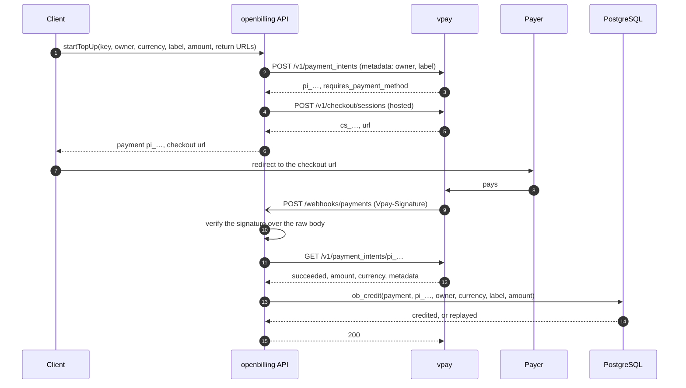
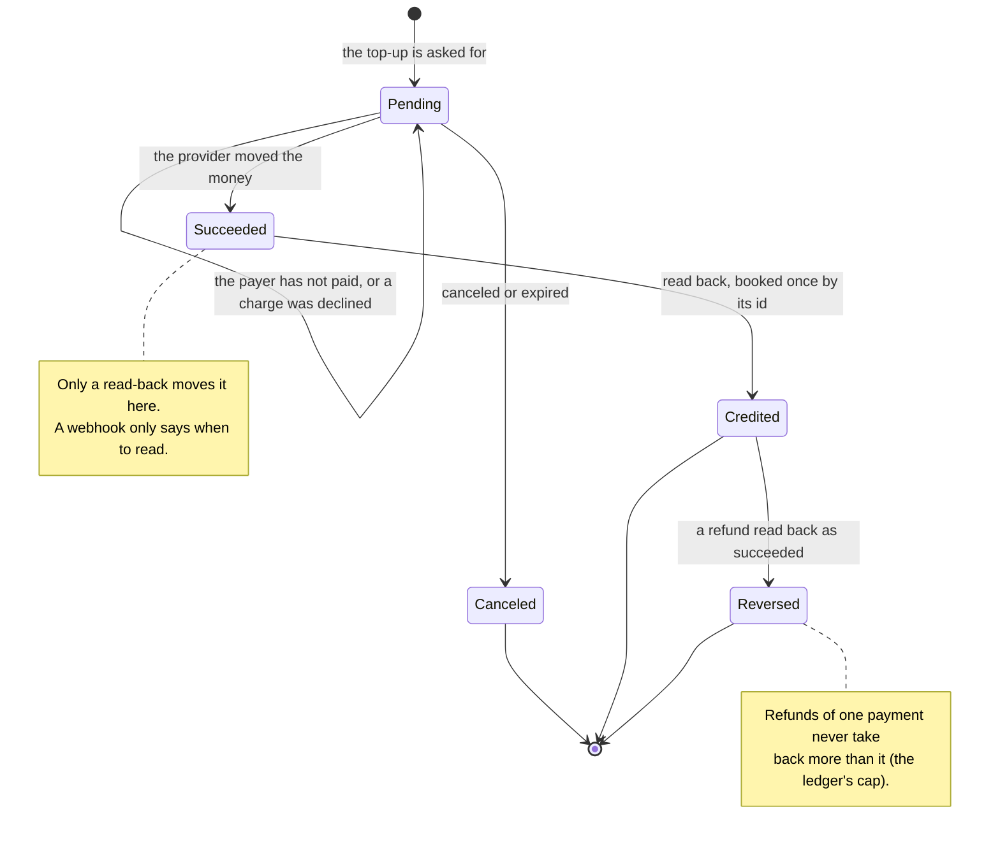

# 0003. Credits come from a payment provider through a port; the external API is CrateStack

Status: **Proposed** (2026-11-27). The owner's decisions quoted under *Context* stand; the rest is for the owner to
confirm. *Amended 2026-11-27 (ANR-1329):* the decision is built: the port, the vpay adapter, the CrateStack API and `serve`
shipped in v0.1.1, the token verifier in v0.2.0 (both in every release since), yet it stays Proposed until the owner
accepts it. *Accepted 2026-11-28 by the owner:* the owner's decision of that day.

*Amended 2026-11-28 (ANR-1332, the token is minted in the adapter):* the owner decided on 2026-11-28 that **the vpay
token is minted inside the adapter**, and it is built: `openbilling-vpay` mints a `vpay:v1` token with an OAuth 2.0
`client_credentials` grant whose client authenticates with an RS256 `private_key_jwt` (RFC 7523). Point 11 and the
*Still open* row about minting are read with this note: `OPENBILLING_VPAY_TOKEN_FILE` still works (something else
mints the token), and the client key (`OPENBILLING_VPAY_CLIENT_ID`, `OPENBILLING_VPAY_CLIENT_KEY_FILE`) is the
other way, never both. The token is minted on first use, replaced before it expires by a configured margin, minted
by one caller while the others wait, retried with a bounded backoff on a transient failure, and a refusal (`400`,
`401`) is a classed error that names vpay's RFC 6749 error code and holds no secret and no token. The client's identity
and endpoints (the client id, its key file and `kid`, the token URL, the assertion audience) are environment variables;
the audience asked for, the scope, the refresh margin and the retries are the configuration file's `vpay.token`, with
documented defaults and no variable (`bin/openbilling/README.md`). **It is proven only against the stand-in**, whose token endpoint verifies the
assertion's signature and claims as vpay's OP does; it has not met a real vpay. The gated workflow
`vpay-sandbox.yml` runs the three conformance cases that need no payer against a real vpay once its variables and
secrets exist, and until it has run green this stays unverified. The original text below is not rewritten.

*Amended 2026-11-28 (ANR-1405, the top-up is recorded and the read-back is compared with it):* the two *Still open*
rows about a payment whose metadata was changed at vpay and about a periodic reconciliation are **built**. **This
reverses the rejected alternative "keep the top-up's target in an openbilling table"**: the reason given there (a
new table and its migration, when vpay carries metadata) did not hold against the risk, because a read-back that is
believed for its target and its amount lets whoever can change a payment at vpay move credit to another account or
credit another amount. Points 3 and 4 are read with this note.

1. **`startTopUp` records the top-up** (`ob_top_up`: payment id, idempotency key, owner, currency, label, amount) right
   after vpay made the payment and before the payer is sent to it; if recording fails the caller gets the error and
   retries with the same key, which gives the same payment (vpay's 24-hour idempotency: *verified 2026-11-28* in the
   `vpay-merchant-api` skill, vpay-skills `19f15ba`, `SKILL.md` and `references/idempotency.md`), recorded again as a
   replay. The account is also checked before vpay is asked, so a typo in the owner or the label leaves no payment
   intent at vpay (the record checks it again, in SQL).
   The same payment recorded with other terms is `top_up_conflict` (`OB011`, class `conflict`); an account that does
   not exist is refused at once as `unknown_account`.
2. **The comparison is SQL** (`ob_settle_top_up`, rule 12): what `read_payment` reports (owner and label from the
   metadata `openbilling_owner` and `openbilling_label`, currency, amount) is compared with the recorded terms, and a
   succeeded payment that agrees is credited from the **recorded** terms, never from the read-back. A difference in
   any field credits nothing, marks the top-up `mismatched` with the first field that differs (`owner`, `label`,
   `currency` or `amount`) and is **sticky**: it is answered again, whatever vpay reports next. The adapter reports
   faithfully and compares nothing. The refusal is `SettleError::ReadBackMismatch`, class `conflict`, naming the field
   and no value; it is counted once in `openbilling.payments.mismatches` (label `field`) and logged as a warning with
   the field and the class: only by the call that marks the top-up (`ob_settle_top_up` answers `o_marked`), never by
   an answer repeated for a mismatch already marked. `reconcilePayment` answers `409`; the webhook acknowledges it (`200`, outcome `mismatch`),
   as it does a payment not settled, because the refusal is final and a retry would read the same.
3. **A succeeded payment with no recorded top-up** (one started before this change, or one openbilling never asked
   for) follows the deployer's `payments.unrecorded`, **`refuse` by default** (fail closed: nothing is credited, a
   mismatch of the field `unrecorded`), or `credit` (as before, from the read-back; for a deployment that has top-ups
   in flight from an earlier version). A payment with no owner reference is not ours either way. The policy is an
   argument of the SQL function, not a literal. Under `refuse` the payment is **recorded** as a `mismatched` top-up of
   the field `unrecorded` (no idempotency key, the owner, currency, label and amount read back), so an operator can list
   it, it is sticky and it is counted once, **with one exception: a late record.** When `startTopUp` created the
   payment at the provider but `ob_record_top_up` failed or was slow, a webhook can settle first and leave this row,
   and the retried record would conflict (`OB011`) on a row that is final: the payer paid and is never credited.
   So `ob_record_top_up`, finding a `mismatched` row of the field `unrecorded` whose owner, currency, label and amount
   equal the terms it records, upgrades it to a normal `pending` top-up carrying the key (answer `false`: this call
   recorded it), unread, and the next settle or reconciliation pass credits it from the recorded terms. If any of the
   four differ it is `OB011` as before and the row stays refused. The guard trigger allows exactly that transition
   (`mismatched`/`unrecorded` with no key to `pending` with a key, terms and creation time unchanged) and no other
   way out of `mismatched`; read values that could not be a row (outside an id's, a label's or a
   currency's alphabet, or an amount not above zero) are refused and counted on every read, since there is nothing to
   keep. **Upgrade path:** a top-up started before this change has no record, so set `payments.unrecorded: credit`
   when upgrading, keep it until every top-up started before the upgrade has finished (at most `reconcile.stop_after`,
   7 days by default, after the upgrade, plus the time a payer takes to pay), then set `refuse`. **Recovering a false
   positive** (a top-up marked mismatched that the operator has checked at vpay and finds right) is, today, manual: an
   operator adjustment credit of the recorded amount to the recorded account, through the API's operator credit. A
   procedure that closes a mismatched top-up and credits its recorded terms is a follow-up (the table's last rows).
4. **Pending top-ups are read back on a timer** (`reconcile_pending`, `serve`, only with a provider): vpay has no
   status filter on its list, so the pending top-ups are listed from `ob_top_up`. `ob_claim_pending_top_ups` takes the
   ones due (at least `reconcile.pending_after` old, less than `stop_after` old, not read in the last `read_again_after`,
   at most `batch`, **the least recently read first**: never read, then by `last_read_at`, then the oldest, so a
   backlog larger than a batch is covered before any top-up is read twice; `ob_top_up_pending_read`, a partial index
   `WHERE state = 'pending'`, serves that order) with `FOR UPDATE SKIP LOCKED` under the `LIMIT`, in a materialized CTE so only the
   batch is locked and the age tests are ranges on `created_at` that `ob_top_up_pending` serves, so any number of instances share the work and a top-up is read by one
   of them at a time; a webhook racing the pass books once, by the ledger's once-only id. Defaults: `pending_after` 15m,
   `read_again_after` 15m, `stop_after` 7d, `every` 1m, `batch` 100 (the configuration file's `reconcile`, ranges in
   `bin/openbilling/README.md`). A pending top-up older than `stop_after` **becomes `expired`**: each pass first runs
   `ob_expire_pending_top_ups` (at most `batch` rows per step, repeated up to ten times while a step is full, the
   oldest first on `ob_top_up_pending`), so the rows the claim scans are the ones in the window however many were
   abandoned (*measured 2026-11-28*, 255 000 rows: 200 000 credited, 50 000 expired, 5 000 pending in the window; the
   claim is one index scan of 13 buffers, 0.4 ms, and the expiry finds nothing in 2 buffers). The reconciler never
   reads an expired top-up. It is not final: a webhook or the operator's `reconcilePayment` still settles it
   (expired to credited, canceled or mismatched; the guard allows nothing else out of `expired`). Counted in
   `openbilling.topups.reconciled` (label `outcome`) and, for the move to `expired`, in `openbilling.topups.expired`
   (no labels). An expired top-up whose payment succeeded but whose webhook never came is **not credited automatically**: an
   operator watches `openbilling.topups.expired` and settles it with `reconcilePayment`. *(Superseded by the amendment
   of 2026-11-28 (ANR-1473) below: a last read now comes before expiry.)*
5. **Proven against the stand-in only**: the stand-in can change a payment's owner, label and amount after it was
   asked for, and the suites hold the behaviour above; vpay itself has not been asked (the sandbox workflow runs
   three cases that need no payer and none of these).

*Amended 2026-11-27 (ANR-1142, a token verifier):* the verifier point 16 waited for is built, as
`crates/openbilling-jwt`, behind the same `TokenVerifier` port. Point 16 carries a marker. What it is:

| # | What | Why |
|---|---|---|
| D1 | **A JWT bearer verifier against one issuer**, configured by `OPENBILLING_AUTH_ISSUER` and `OPENBILLING_AUTH_AUDIENCE` (both or neither). With neither, the service keeps `RefuseAll`; nothing is ever open by default | Fail closed, as point 16 says |
| D2 | **What a token must be**: a compact JWS with no `crit`; `alg` `RS256`, `ES256` or `EdDSA` (Ed25519), never `none` or `HS*`, and the algorithm of the key its `kid` names; `iss` exactly the issuer; `aud` holding exactly the audience; `exp` required and not passed, `nbf` honoured, 60 s of leeway; `sub` an owner id | The usual resource-server checks; a public key can never be used as an HMAC secret |
| D3 | **Keys from the issuer's JWKS**, found through its discovery document (which must name the issuer exactly) or a configured URL, `https` or loopback `http` only, no redirects; kept 5 minutes, fetched again early for an unknown `kid` at most every 30 s, served stale for an hour while the issuer is down, and `503` after that, never an acceptance | An issuer that rotates keys is followed; an unknown `kid` cannot make the service hammer the issuer |
| D4 | **Roles from a configured claim** (a dotted path, `roles` by default), mapped by a configured table to `operator` and `producer`; an unnamed value gives no role. An owner needs no role: `sub` is the owner | Issuers name roles their own way (Keycloak's `realm_access.roles`, for one) |
| D5 | **Signatures on ring.** jsonwebtoken 11 checks the claims, with a crypto provider of the crate's own on ring. Authkestra's resource server (`authkestra-resource` 0.15.3) was the first choice and is not used: it depends on jsonwebtoken's `rust_crypto` backend, which brings `rsa` 0.9 under RUSTSEC-2023-0071 (patched only in `rsa` 0.10; *verified 2026-11-27*, rustsec/advisory-db), which `cargo deny` refuses, and a second crypto library beside ring. jsonwebtoken's other backend is aws-lc-rs, which this workspace keeps out | One crypto library, the one rustls already uses here |
| D6 | **The default address stays `127.0.0.1:8080`**; binding beyond it is the operator's `OPENBILLING_LISTEN` once an issuer is configured | The listener does not open itself because a setting appeared |

Not built: DPoP or mTLS-bound tokens, several issuers at once, token introspection, a conformance suite for
`TokenVerifier` (the verifier's own tests and the end-to-end suite hold it).

## Summary

openbilling never touches card or wallet data. To take money it asks a **payment provider**, through a port, for a
payment (a **top-up**), and sends the payer to the provider's checkout. It books a `payment` credit only when the
provider, **read back**, says the payment succeeded; a webhook is a hint that names what to read again. The credit is
once-only by the provider's payment id, through the ledger's existing credit function. A refund the provider says it
paid back becomes a reversal, which the ledger caps at the payment. **vpay** is the first adapter.

Promotions and adjustments are not payments: they come from the operator, through the API.

The **external API is CrateStack**: on-demand queries over the ledger's tables, custom selects as `query` blocks,
policies on every read and write, and mutation procedures whose Rust bodies call the ledger's PostgreSQL functions.
Internal operations (the drain, partitions, reconciliation, long reports) stay Rust calling PostgreSQL functions.

## Context

The owner, 2026-11-27:

- *"Also make it interoperable with vpay via a good and clean API surface."*
- *"Not always payments right? It can be promotional money intake"*: credit has three sources, `payment`,
  `promotion` and `adjustment` (ADR 0002), and only a payment carries the reversal cap.
- *"If something can be done in SQL, we better use SQL rather than rust"*: the ledger's rules are SQL (ADR 0002,
  points 15 to 21); this decision adds none in Rust.
- *"keep queries normal, and only mutation procedures [use] postgres's procedures … We can simply call the postgres
  procedures in the implementation of the mutation procedure."*
- *"I prefer queries on demand provided by cratestack, with custom selects and stuffs for external clients. For our
  internal operations or custom and long queries, we should use procedures."*

[vpay](https://github.com/vaam-apps/vpay) is a public payment orchestrator with a Stripe-shaped merchant API. What
this record says about it was read in vpay's source at `8b56831` and in its skills (`vaam-apps/vpay-skills` at
`19f15ba`, vendored in `.agents/skills/vpay*` and pinned in `skills-lock.json` since 2026-11-27, the owner's choice); each fact is listed, with its file, under *Agent notes*.

## Decision

### The payment provider port

1. **A port, `PaymentProvider`**, in `openbilling-core`: create a payment, read a payment, read a refund, verify and
   parse a webhook. A conformance suite in `openbilling-testkit` (`payment_conformance!`) runs against a stand-in for
   the provider that the adapter reaches over HTTP exactly as it reaches the real one.
2. **openbilling holds no payment instrument.** A top-up names the account it credits (owner and label; the currency
   is the payment's), an amount in micro-units and where the payer returns. The provider answers a payment id and a
   checkout (an id, and a URL to send the payer to). The URL may carry the checkout's credential and is never logged.
3. **Only a read-back credits.** A payment's status is whatever `read_payment` answers; a webhook only says which
   payment or refund to read. A verified signature changes nothing about that: it only lets the read happen sooner.
4. **A succeeded payment is one `payment` credit**, keyed by the provider's payment id, to the owner's account with
   the payment's label in the payment's currency, through `ob_credit`. Settling it again (a second webhook, a
   reconciliation) is the ledger's replay. A payment openbilling did not ask for (the provider's record carries no
   owner and label) credits nothing.
5. **A refund reverses only when the money went back**: a refund read back as succeeded is one reversal keyed by the
   provider's refund id, through `ob_reverse`, whose trigger caps it at the payment. A pending, failed or canceled
   refund books nothing. The payment is settled first, so a refund that arrives before its payment's webhook still
   finds its credit.
6. **Only `payment` credits come from a provider.** The operator's API books `promotion` and `adjustment` only; its
   credit procedure has no `payment` source to name.
7. **Statuses are the port's, closed**: a payment is `pending`, `succeeded` or `canceled`; a refund `pending`,
   `succeeded`, `failed` or `canceled`. An adapter maps its provider's statuses and refuses one it does not know.

### vpay, the first adapter

8. **A top-up is a vpay PaymentIntent and a hosted Checkout Session.** The intent carries the owner and the label in
   its `metadata` (`openbilling_owner`, `openbilling_label`), read back with it; the session gives the payer's URL.
   Each `POST` carries an `Idempotency-Key` derived from the caller's key (`openbilling:<key>:payment_intent`,
   `…:checkout_session`), so a retried top-up is the same payment within vpay's 24-hour window.
9. **Amounts are scaled, never converted**: vpay's amounts are integers of the currency's minor unit, openbilling's
   are micro-units. The adapter is configured with each currency's exponent and refuses a top-up that has no exact
   minor-unit value (`inexact_amount`).
10. **Webhooks are verified exactly as vpay specifies**: `Vpay-Signature: t=<seconds>,v1=<hex>[,v1=…]`, HMAC-SHA256
    over the literal `t` text, `.` and the raw body, any configured secret against any `v1`, in constant time, within
    300 seconds either way, and the body parsed only afterwards. Two `Vpay-Signature` headers are refused.
11. **Authentication to vpay is a bearer token read from a file on every call**, so whatever mints and rotates it
    runs beside the service. The vpay deployment must permit `machine_tokens`. *(2026-11-28: the adapter can also
    mint the token itself; see the amendment at the top.)*

### The external API

12. **CrateStack serves it**, from `crates/openbilling-http/schema/openbilling.cstack`, under `/v1`, over REST and
    JSON. The ledger's tables stay the hand-written migrations' (ADR 0002): the models are `@@map`ped onto them,
    `cratestack migrate` is never run on this schema and keeps no snapshot, and every model is read-only (its write
    routes are removed with `@@internal`).
13. **Reads for external clients**: the models `Account`, `Lot` and `UsageOutcome`, queried on demand (filters,
    fields, sort, paging); and `query` blocks of plain SQL for the reads that are not one table (balance, `allowed`,
    credits, the monthly statement, the usage series), each served by a read procedure. CrateStack's `view`s are
    database views that only its migrations create, so they are not used.
14. **Writes are mutation procedures** whose Rust bodies call the ledger's functions through `PgLedger`:
    `configure`, `openAccount`, `grantCredit` (promotion or adjustment), `recordUsage`, `startTopUp`,
    `reconcilePayment`, `reconcileRefund`. *Amended 2026-11-27 (ANR-1142): and `recordRawUsage`, `setDebtLimit`,
    `setMemberCap`, `loadPriceList`.*
15. **Every model, query and procedure has a policy.** An owner reads their own accounts, lots, outcomes, balances and
    statements (`auth().sub`); the role `operator` reads and runs everything; the role `producer` sends usage and asks
    `allowed`. A denied model read is a `404` or an empty list; a denied procedure is a `403`.
16. **Callers are authenticated, fail closed.** CrateStack's `AuthProvider` takes a bearer token and asks a
    `TokenVerifier` port; no token, or one it refuses, is a `401` before anything runs. The service ships with
    `RefuseAll`, so until a real verifier is wired every `/v1` call is a `401`. It binds to `127.0.0.1` by default.
    *Amended 2026-11-27 (D1 to D6): the JWT verifier is built; `RefuseAll` stays the default when no issuer is set.*
17. **Every write carries an `Idempotency-Key`**: a mutation without one is a `400`. CrateStack's idempotency layer
    answers a replay with the first answer for 24 hours. The operation's own once-only id is in its arguments too
    (the account id, the credit id, each event's id, the top-up key), so a replay after that window is still the
    ledger's replay.
18. **Amounts on the wire are micro-units as CrateStack's `BigInt`**, a decimal string in JSON, so a JavaScript
    client cannot round them; each sits beside its currency code.
19. **The provider's webhook is a plain axum route** beside the CrateStack router, `POST /webhooks/payments`, because
    it needs the raw body and the signature header.
20. **The contract is CrateStack's**, not an OpenAPI document (CrateStack 0.20.6 generates none): the contract lock
    `openbilling.contracts.lock` and the operation list `docs/api/ops.json`, both checked in CI.

### Internal operations

21. **The drain, the partitions and reconciliation run in Rust, calling the ledger's functions**: `serve` runs the
    drain on `LISTEN/NOTIFY` with a poll, and prepares partitions hourly.

## Diagrams

A payment stays `pending` while the payer has not paid; vpay has no failed intent, a declined charge falls back to
waiting for a payment method. `Credited` and `Reversed` are the ledger's: the credit and each reversal are once-only
by their provider ids.

## Consequences

**Good**

- openbilling stays out of the payment instrument's scope: it never sees card or wallet data.
- A forged, replayed or reordered webhook can at worst make openbilling read the provider early.
- One credit per payment, whoever settles it first, and refunds capped at the payment, by the ledger's own rules.
- Another provider is another adapter that passes the same suite; the API and the ledger do not change.
- Clients get filters, projections, sorting and paging on the models for free, with policies enforced in the SQL.

**Bad, or to be managed**

- **Nothing is served to callers until an issuer is configured**: without one the service keeps `RefuseAll`
  (amended 2026-11-27: a JWT verifier ships, D1).
- **A payment's target lives in vpay's metadata**, not in openbilling. A payment whose metadata is edited at vpay
  credits another account of the same owner, or none.
- **vpay's refunds never reach `succeeded` today** (*verified*, below): no reversal will be booked from vpay until it
  settles refunds.
- **The vpay token is minted outside the service** (*2026-11-28: unless a client key is configured, see the amendment
  at the top*). If it expires, top-ups and reads answer `503` or `500` until it
  is rotated.
- **CrateStack's `query` blocks are not HTTP routes**, so each read that is not a model needs a read procedure that
  forwards to it.
- **The workspace MSRV rises to 1.98**, CrateStack 0.20.6's.
- **CrateStack's CBOR crate is BlueOak-1.0.0** (`minicbor`, `minicbor-serde`), allowed for those two crates only.

## Alternatives rejected

| Alternative | Why not |
|---|---|
| Credit on the webhook's word | A webhook can be forged, replayed or reordered; vpay's own rule is that callbacks are hints |
| Keep the top-up's target in an openbilling table | A new table and its migration; vpay carries metadata and answers it on every read |
| Reverse on a pending refund | vpay can still fail the refund, and the money would stay with the merchant |
| Sign vpay requests (COSE_Sign1) | The adapter would carry vpay's whole signed transport; a bearer token is what vpay offers beside it |
| Hand-written axum routes and a utoipa OpenAPI document | Written and then thrown away on the owner's choice of CrateStack: its policies, on-demand queries and contract replace it |
| CrateStack views for balance and `allowed` | They are database views only `cratestack migrate` creates; `query` blocks run the same SQL with no object to own |
| A per-provider credit source | ADR 0002 has one `payment` source; the provider's id is the key, and providers' ids do not collide in practice |

## Still open

| Question | Recommendation |
|---|---|
| ~~A real token verifier: a JWT against an issuer's keys~~ | ~~Authkestra's resource server or CrateStack's multi-issuer JWKS verifier behind the `TokenVerifier` port; then bind beyond `127.0.0.1`~~ **Built 2026-11-27** (D1 to D6): `openbilling-jwt`, on jsonwebtoken and ring |
| Several issuers, DPoP-bound tokens | One issuer, plain bearer tokens, as built; add a trust map and DPoP when a deployment needs them |
| An `Idempotency-Key` is namespaced by the exact `Authorization` header (CrateStack 0.20.6's default fingerprint, *verified 2026-11-27* in `cratestack-axum-0.20.6/src/idempotency/fingerprint.rs`), so a retry with a refreshed token is not replayed by point 17's layer: it runs again, and the ledger's once-only ids answer it (the end-to-end suite's once-only scenario shows both) | Key the layer on the verified `sub` (`with_principal_fingerprint`, after the token is verified) so a key survives a token refresh; until then point 17's second sentence is what holds |
| ~~Minting and rotating the vpay token~~ | ~~A `client_credentials` client with an RS256 `private_key_jwt` beside the service, or in the adapter~~ **Built 2026-11-28** (ANR-1332), in the adapter, as the owner decided; proven against the stand-in only, see the amendment at the top |
| The token minting against a real vpay | Run `vpay-sandbox.yml` once a sandbox, a registered client and its key exist: it runs 3 of the suite's 9 cases (the others need a payer to act) |
| ~~Payments whose `metadata` was changed at vpay~~ | ~~Record the top-up's target in openbilling when it is created, and refuse a read-back that differs~~ **Built 2026-11-28** (ANR-1405), see the amendment at the top: a mismatch is final, and no operator procedure resolves it yet |
| ~~A periodic reconciliation of pending top-ups~~ | ~~List pending payments and read each back, as vpay's reconciler does for rails~~ **Built 2026-11-28** (ANR-1405), from openbilling's own table, since vpay's list has no status filter |
| Resolving a mismatched top-up | A mismatch is sticky and only reported (a counter, a warning, a `409`). An operator procedure that closes one after a person looked (credit the recorded terms, or write it off) is not built; it needs the owner's rule for who may decide |
| An unrecorded payment: one vpay holds that openbilling never recorded | `startTopUp` records after vpay answers; a crash between the two leaves a payment vpay holds and openbilling never recorded, which `payments.unrecorded` then decides (under `refuse` it is kept as a mismatched top-up for the operator). Recording first needs a payment id vpay has not given yet |
| Payment ids of two providers in one ledger | A provider prefix in the credit id when a second adapter comes |
| Chargebacks from vpay | vpay has none; map them when a provider reports them |
| ~~Raw events through the API (ADR 0004)~~ | ~~A `recordRawUsage` mutation over `PriceBook::intake_raw`, and an operator's `loadPriceList`; `recordUsage` takes pre-priced events only~~ **Built 2026-11-27** (ANR-1142): `recordRawUsage` and `loadPriceList` as recommended, with `setDebtLimit` and `setMemberCap`; `UsageOutcome` carries a raw event's rating, and a statement's usage lines are per day and meter |
| Opening and closing balances on the statement | Need the expiry entries ADR 0002 leaves open |

## Agent notes

Each fact about vpay, *verified 2026-11-27* in vpay `8b56831` unless marked otherwise:

| Fact | File |
|---|---|
| `IntentStatus`: `requires_payment_method`, `requires_action`, `processing`, `succeeded`, `canceled`; no `failed` | `backends/crates/vpay-core/src/state.rs` |
| `RefundStatus`: `pending`, `succeeded`, `failed`, `canceled` | the same |
| PaymentIntent create: `amount` (minor units, positive, at most 2^53 − 1), `currency`, `payment_method_types[]` (at least one), `metadata` (50 keys, 40 and 500 characters) | `backends/crates/vpay-api/src/v1/payment_intents.rs` |
| A currency's exponent is the currency's (`Currency::exponent`) | `backends/crates/vpay-core/src/money.rs` |
| A Checkout Session references an intent in `requires_payment_method`; `ui_mode` `hosted` needs `success_url` and `cancel_url` and answers a `url` holding the session's secret | `backends/crates/vpay-api/src/v1/checkout_sessions.rs`, `model.rs` |
| Bodies are bracket-nested form encoding with literal brackets and `encodeURIComponent` escaping | `sdks/rust/src/form.rs`, `backends/crates/vpay-api/src/form.rs` |
| Every `POST` under `/v1` needs an `Idempotency-Key` (at most 255 bytes of printable ASCII); the same key with another body is `400` `idempotency_error` | `vpay-merchant-api` skill (vpay-skills `19f15ba`), `references/idempotency.md` |
| `/v1` takes a bearer token of audience `vpay:v1` where `auth.methods` permits `machine_tokens`; a token caller gets plain JSON | `vpay-merchant-api` skill (vpay-skills `19f15ba`); `backends/crates/vpay-api/src/resource_auth.rs` |
| The OP signs `private_key_jwt` with RS256 | `backends/crates/vpay-api/src/op/clients.rs` |
| `Vpay-Signature` grammar, HMAC over the literal `t` text, one `v1` per secret, 300 s tolerance either way, constant-time compare | `backends/crates/vpay-worker/src/signing.rs`, `sdks/rust/src/webhooks.rs` |
| Event types: `payment_intent.*`, `charge.refunded`, `charge.refund.updated` among fifteen | `backends/migrations/0039_events-customer-created-updated.sql` |
| A refund is created `pending` and nothing settles it; `succeeded` is reached by nothing a merchant can cause | `vpay-merchant-api` and `vpay-webhooks` skills (vpay-skills `19f15ba`) |
| Callbacks are hints: only the authenticated status query moves money | `vpay` skill (vpay-skills `19f15ba`) |
| CrateStack 0.20.6: models `@@map` onto existing tables; `view`s are database views created by its migrations; `query` blocks run through `db.queries()` and have no route; no OpenAPI, a contract lock and `contract ops` | `.agents/skills/cratestack-*`, `cratestack-macros-0.20.6/src/view/descriptor.rs`, `src/query/accessor.rs` |

Added 2026-11-28 (ANR-1332), each *verified 2026-11-28* in vpay `7a9fee5` (`master`) unless marked otherwise:

| Fact | File |
|---|---|
| The token endpoint is `{public_base_url}/v1/oauth/token`, a form `POST`: `grant_type=client_credentials`, `client_id`, `client_assertion_type=urn:ietf:params:oauth:client-assertion-type:jwt-bearer`, `client_assertion`, `audience=vpay:v1`, and `scope` only when the client asks for one | `docs/flows/merchant-auth.md`, `backends/crates/vpay-api/src/op/token.rs` |
| Without `audience=vpay:v1` the token has `aud = client_id` and every `/v1` call is a bare `401` | `docs/flows/merchant-auth.md` |
| The assertion: RS256, `iss` = `sub` = `client_id`, `aud` the token endpoint URL or the issuer `{public_base_url}/v1/oauth` as one string, `jti` fresh and spent once, `exp` 1 to 300 s from now (60 by default), `iat`; `kid` optional with one registered key and required with several | `docs/flows/merchant-auth.md`, `backends/crates/vpay-api/src/op/clients.rs` |
| The assertion's `aud` is the OP's name for itself, not the URL posted to: a merchant that reaches vpay by another URL must say so | `docs/flows/merchant-auth.md` |
| The grant is `client_credentials` alone; the client authentication method is `private_key_jwt` alone | `backends/crates/vpay-api/src/op/mod.rs` (`OP_GRANT_TYPES`, `OP_TOKEN_ENDPOINT_AUTH_METHOD`) |
| A token request that names no `scope` is granted the client's registered scopes | `backends/crates/vpay-api/src/op/token.rs` |
| The answer is `{access_token, token_type: "Bearer", expires_in, scope}`, `expires_in` 900 and not configurable, no refresh token; an error is RFC 6749's `{error, error_description}` with `400` or `401` | `backends/crates/vpay-api/src/op/mod.rs` (`ACCESS_TOKEN_TTL_SECS`), `docs/flows/merchant-auth.md` |
| The endpoint exists only where `auth.methods` permits `machine_tokens` (otherwise `404`); the SDKs cache a token until `expires_in` minus 30 s | `docs/adr/0037-authentication-methods-are-deployment-configuration.md`, `op/mod.rs` |
| *Unverified:* that a real vpay sandbox accepts an assertion from this adapter; that its `kid` and registered scopes match a configuration; that `docs/flows/merchant-auth.md`, which calls the OP's door "closing" (VP-4), describes a deployment that still serves it | none: run `vpay-sandbox.yml` |

The webhook test vector (`crates/openbilling-vpay/tests/vectors/vpay-signature.hex`) is the HMAC-SHA256 of
`1753401600.` and the body of vpay's own verifier tests under their secret, computed with `openssl dgst` on
2026-11-27.

*Amended 2026-11-28 (ANR-1473, one last read at expiry):* point 4's gap is closed. A pending top-up that reaches
`reconcile.stop_after` is read back from the provider one last time and settled; only one **still pending at the
provider** becomes `expired`, so `expired` keeps one meaning: a last read showed it unpaid. A paid top-up that never
got a webhook ends `credited` with no operator. How: `ob_claim_expiring_top_ups` claims the pending rows at least
`stop_after` old and not claimed in the last `read_again_after` (the same touch of `last_read_at`, `FOR UPDATE SKIP
LOCKED`, disjoint from the due claim, which takes the rows younger than `stop_after`); each is settled as any read
(credited, canceled or mismatched close it); a read that still says pending moves it with `ob_expire_top_up`, an
update that matches only a row still pending and old enough, so a webhook that credited it meanwhile makes the move
a no-op (`false`) and the guard is never reached. A read that fails as `unavailable` leaves the row pending (it is
claimed again after `read_again_after`, which also covers a crash between claim and settle); any other failure expires
it unread. The backstop `ob_expire_pending_top_ups` stays, now at `stop_after + reconcile.last_read_for` (default 1d,
`1m` to `30d`), so a provider that keeps failing does not keep a row pending for ever. A pass reads at most `2 * batch`
payments (the last reads first, then the due ones). Metrics add no label: `openbilling.topups.reconciled` gains the
outcome `expired` (a last read found it still pending) and its other outcomes count last reads too;
`openbilling.topups.expired` counts every move to `expired`, after a last read, unread, or by the backstop. Proven
against the stand-in only.
