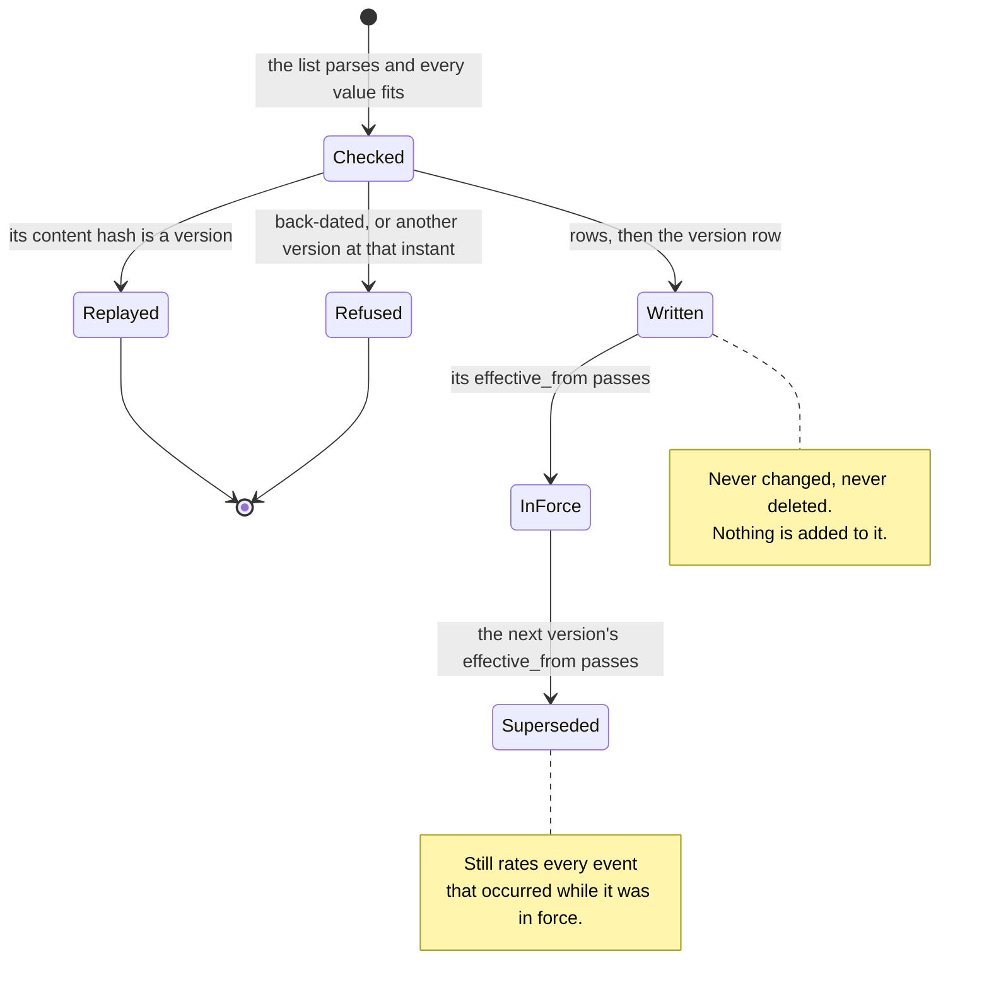

# 0004. A versioned price book in SQL

Status: **Accepted** (2026-11-27), slice 3, built on the owner's decisions of that day (PostgreSQL 19 the minimum;
rules in SQL; amounts in integer micro-units; writes that carry a rule are functions called from Rust, plain reads
are plain queries, and the external read API is CrateStack's). The judgement calls under *Still open* are for the
owner to confirm.

## Summary

A **price book** is a list of **versions**. A version takes effect at one instant (`effective_from`) and holds, for
each **meter** it declares, the **dimension keys** the meter is priced by and its **prices**: an integer number of
micro-units per an integer number of the meter's unit, in one currency, for exactly one set of dimension values. A
version is loaded from a YAML price list, all or nothing, once per content; it never changes and is never
back-dated.

A **raw event** carries a meter, a quantity and its dimensions instead of an amount. Intake rates it by the version
in force at its occurrence time, rounds once to the micro-unit, half to even, and then takes it through the ledger's
once-only intake and drain (ADR 0001) like a priced event. The event and its outcome keep the version that rated it.
An unpriced meter or dimension is refused at intake, never priced at a guess.

Every rule is SQL in `openbilling-pg`'s migrations `…005_rated_events.sql` and `…006_price_book.sql`. Rust parses
the YAML and passes its values, with their lines, to one function.

## Context

ADR 0001 (points 18 to 20) set the frame: versions that never change, an event rated by the version in effect at its
occurrence time with that version stored on its outcome, no back-dating, integers only. Its *Still open* table
recommended prices as an integer amount per an integer quantity, rounded once per event, half to even. Slice 2 took
pre-priced events only (ADR 0001, amended, B4). This slice builds the price book.

Three needs shape it:

- **Prices below one micro-unit per unit.** A token often costs a fraction of a micro-unit. An integer price per an
  integer `per` (for example 150 micro-units per 1 000 000 tokens) is exact; a float never is.
- **A list an operator writes by hand.** A file is easy to review and keep in version control; loading the same file
  twice must change nothing, and a mistake must be refused with its line.
- **No billing at a guess.** An event whose meter or dimensions the version does not price is refused, so the producer
  learns at once.

## Decision

### The price book

1. **One price book per deployment**, a list of versions. The version in force at an instant is the one with the
   greatest `effective_from` not after it, under `UNIQUE (effective_from)` (ADR 0001, amended, A4: no temporal key).
2. **Tables, named plainly** so a CrateStack `@@map` can read them later: `ob_price_version` (`version_id` from
   `uuidv7()`, `effective_from`, `content_hash`, `loaded_at`), `ob_price_meter` (`version_id`, `meter`, `unit`),
   `ob_price_dimension` (`version_id`, `meter`, `dimension`), `ob_price` (`version_id`, `meter`, `currency`,
   `dimensions` as a jsonb object, `price_micros`, `per_units`).
3. **A price is a rational**: `price_micros ≥ 0` micro-units of the currency per `per_units ≥ 1` units. A price of
   zero is a price (a free meter is stated, not guessed).
4. **Prices are per currency.** A meter priced in EUR and not in USD is unpriced for a USD event. Nothing converts
   (agent guide, rule 3).
5. **A meter is priced by exactly its own dimension keys.** A price names a value for each of its meter's keys and for
   no other; an event matches a price only when its dimensions are the same object.

### The price list and its loader

6. **The YAML form.** `effective_from` (`YYYY-MM-DDTHH:MM:SS`, an optional fraction of one to six digits, and `Z`),
   `meters` (each a `name`, an optional `unit` and optional `dimensions`), `prices` (each a `meter`, a `currency`,
   optional `dimensions`, `price_micros` and an optional `per`, 1 when left out). No other key. Names (meters, units,
   dimension keys) are 1 to 64 bytes of `a`–`z`, `0`–`9`, `.`, `_`, `-`; dimension values follow the rule of ids.
   ```yaml
   effective_from: "2026-12-01T00:00:00Z"
   meters:
     - name: tokens.input
       unit: token
       dimensions: [model]
     - name: compute.seconds
   prices:
     - meter: tokens.input
       currency: EUR
       dimensions: { model: example-small }
       price_micros: 150
       per: 1000000
     - meter: compute.seconds
       currency: EUR
       price_micros: 40
   ```
7. **Parse in Rust, validate in SQL, all or nothing.** The store parses with `serde-saphyr` (pure Rust, no panic on
   input, a budget on what a document may cost, a key given twice refused) and refuses what does not parse as a price
   list as `malformed_price_list` at the parser's line and column. It never keeps the parser's message, which may
   quote the list (agent guide, rule 9). Everything else is `ob_load_price_list`, one call, which checks in order and
   refuses the first value that breaks a rule, naming its line and column and its key (for example
   `prices[2].currency`): `invalid_price_list` (a value outside its form), `price_list_duplicate` (a meter, a
   dimension key or a price twice), `price_list_mismatch` (a price for a meter not declared, or with dimensions that
   are not its meter's), `unknown_currency` (a currency the operator has not named). A key is built from the list's
   structure, never from its content.
8. **Once-only by a content hash.** The hash is SHA-256 over a canonical document of the version: the time in UTC to
   the microsecond, the meters sorted by name (each with its unit and its sorted dimension keys), the prices sorted by
   meter, currency and dimensions, as jsonb text, behind a fixed prefix. So two lists that differ only in layout,
   comments, order or the spelling of the time are one version; loading either again answers that version,
   `replayed`. The time is part of the content: the same prices at another time are another version, which is how a
   price returns to an earlier value.
9. **A version never changes.** Its four tables refuse `UPDATE`, `DELETE` and `TRUNCATE` (triggers, `OB901`). Its
   rows are written first and the version row last: a trigger on the version row checks that its hash is the hash of
   its rows (`OB903`), and a trigger on each child table refuses a row for a version that already exists (`OB901`). So
   nothing can be added to a version once it is written, whoever writes.
10. **No back-dating, made exact.** ADR 0001, point 19, says a version takes effect at or after the time it is
    published. Rating at intake (point 12 below) adds a case: an event may occur up to the skew allowance ahead of the
    clock, so an event already rated by one version may occur after a version published later takes effect. A version
    is therefore refused (`back_dated`) unless it takes effect **after the clock and after the occurrence time of
    every event already rated**. The second half reads a partial index of the rated events that occurred after they
    were received, which is the only place such an event can be. A version taking effect at the same instant as
    another is `version_conflict`.
11. **The lock.** Writing a version takes `ob_price_version` in `EXCLUSIVE` mode; rating at intake takes it in
    `ROW SHARE` mode, which conflicts with it; a plain read (`ACCESS SHARE`) conflicts with neither (PostgreSQL
    documentation, 13.3.1 *Table-Level Locks*: *unverified* against the 19 pages, which were not re-read for this
    record). So a version is written while no intake is rating, its back-dating check sees every event rated before it,
    and an intake that rates after it sees it. An intake waits for a load (rare, short) and a load for the intakes
    rating at that moment; drains never take the lock.

### Rating

12. **Raw events are rated at intake**, not by the worker (ADR 0001, point 12, amended). The producer learns of an
    unpriced event at once, the amount on the queue row is final, and the drain is unchanged.
13. **The amount is `quantity × price_micros ÷ per_units`**, computed in `numeric` (exact for any `bigint` quantity
    and price), **rounded once per event to the micro-unit, half to even**: a remainder of more than half goes up, less
    than half goes down, exactly half goes to the even neighbour. `ob_round_half_even` is the one rounding; PostgreSQL's
    own `round(numeric)` rounds a half away from zero (`round(2.5) = 3`, observed on PostgreSQL 16.15; *unverified* on
    19), so it is not used. An amount past the largest `Amount` is refused (`overflow`), never clamped.
14. **Refusals.** At intake, in order after the window: `unpriced_meter` (no version in force, or the meter has no
    price in the currency in it), `unpriced_dimension` (the meter is priced in the currency, but not for these
    dimensions: a value with no price, a key left out or a key it is not priced by), `overflow`; each names its events
    and refuses the whole batch. `negative_quantity` is checked with the amounts. `RefusalReason::NoPrice`, which the
    drain could decide, stays reserved: no drain decides it now.
15. **`ob_rate`** rates one raw event and writes nothing: the amount and the version, or the same refusals naming no
    event. It is a function, not a query, because a plain statement cannot raise a refusal's SQLSTATE.

### Raw intake

16. **One intake for both kinds.** `ob_intake` takes rows that are priced (an amount) or raw (a meter, a quantity and
    dimensions), keeps every rule of ADR 0001 in its order, and rates the raw rows after the window and before the
    sums. A priced batch and a raw batch are two calls of the port (`intake`, `intake_raw`) and one function.
17. **The payload hash of a raw event covers its meter, quantity and dimensions** (ADR 0001, point 3, which named
    them): SHA-256 over `{"currency","dimensions","member","meter","occurred_at","owner","quantity"}` with sorted keys,
    the dimensions an object sorted byte by byte, and no amount (the service computes it). **This changes the hash** of
    an event that is raw; a priced event keeps the hash of slice 2, so its stored events and its test vector are
    untouched. A raw and a priced event with one id and day are a conflict.
18. **The stored event keeps its rating**: `ob_usage_event` and `ob_event_outcome` gain `meter`, `quantity`,
    `dimensions` and `price_version`, all set for a raw event and all null for a priced one. The outcome keeps them so
    a statement can be derived again from the outcomes and the versions they name once the partition is gone (ADR 0001,
    point 18). No foreign key to the version: every insert would take a key-share lock on the one row in force, which
    many intakes at once turn into multixacts; versions are never deleted.
19. **Pre-priced intake stays.** It serves a producer that rates elsewhere (an external rater, or a one-off charge
    with no meter), and it keeps slice 2's suite as it is. Its events name no version.

### The port and where things live

20. **`PriceBook: LedgerStore`** in `openbilling-core`: `load_price_list`, `price_versions`, `rate`, `intake_raw`;
    `openbilling-testkit` holds its conformance suite, `price_book_conformance!`. `PgLedger` implements it.
21. **Writes and internal operations are functions; plain reads are queries.** Loading, rating and intake are
    functions called as `SELECT … FROM fn($1, …)`. `price_versions` and `outcome` are parameterized queries over the
    tables (`ob_outcome_of` is dropped). No external read API for the price book is built here: reads for clients will
    be CrateStack models or views over these tables.

| SQLSTATE | Rule | Names |
|---|---|---|
| `OB109` | `negative_quantity` | events |
| `OB110` | `unpriced_meter` | events |
| `OB111` | `unpriced_dimension` | events |
| `OB108` | `overflow` (also a raw event rated past the largest amount) | events |
| `OB201` | `invalid_price_list` | position |
| `OB202` | `price_list_duplicate` | position |
| `OB203` | `price_list_mismatch` | position |
| `OB204` | `unknown_currency` (in a price list) | position |
| `OB205` | `back_dated` | position, or nothing when the trigger refuses a version written directly |
| `OB206` | `version_conflict` (class `conflict`) | position |
| `OB903` | a version whose hash is not its rows': a fault | |

## Diagrams

```mermaid
sequenceDiagram
    autonumber
    participant O as Operator
    participant S as PgLedger
    participant DB as PostgreSQL
    participant P as Producer
    O->>S: load_price_list(yaml)
    S->>S: parse; refuse malformed at its line
    S->>DB: SELECT … FROM ob_load_price_list(values, lines)
    DB->>DB: check each value; refuse the first at its line and key
    DB->>DB: LOCK ob_price_version IN EXCLUSIVE MODE
    alt the same content hash exists
        DB-->>S: that version, replayed
    else back-dated or the same instant
        DB-->>S: refused (back_dated, version_conflict)
    else
        DB->>DB: insert meters, dimensions, prices, then the version (seal)
        DB-->>S: the new version
    end
    P->>S: intake_raw(events)
    S->>DB: SELECT … FROM ob_intake(rows)
    DB->>DB: ADR 0001's checks up to the window
    DB->>DB: LOCK ob_price_version IN ROW SHARE MODE
    DB->>DB: rate each by the version in force at its time, half to even
    alt unpriced, or past the largest amount
        DB-->>S: refused, naming the events
    else
        DB->>DB: sums; INSERT … ON CONFLICT DO SELECT, with amount and version
        DB-->>S: accepted or replayed
    end
```



## Consequences

**Good**

- A price below a micro-unit per unit is exact, and an event's amount is one rounding of an exact product.
- The same list loads once whatever its layout; a mistake is refused with its line, and nothing is half-loaded.
- An event's rating is fixed when it is taken in and kept with it; a statement can be derived again from the outcomes
  and the versions, which never change.
- No version can take effect where an event already rated by another one lies, so "the version in force at its time"
  is exact for every stored event.
- An unpriced event is refused while its producer is still connected, so usage is never billed at a guess or lost
  silently in the queue.

**Bad, or to be managed**

- **A version must take effect after the clock**, so a list is published ahead of time; a fresh deployment cannot
  rate an event that occurred before its first version.
- **Rating at intake takes a table lock in `ROW SHARE` mode** on every raw batch, and a load makes raw intakes wait for
  its duration. Both are short; a load is rare.
- **The parser is a dependency** (`serde-saphyr` and what it brings: `granit-parser`, `annotate-snippets`,
  `encoding_rs` and others, all MIT or Apache-2.0, `encoding_rs` also BSD-3-Clause; `cargo deny` was not run where this
  was written: its advisories are *unverified* until CI runs it). It moves fast (2.2.0 on 2026-11-18).
- **A dimension the meter is not priced by refuses the event**, so a producer that adds a dimension must wait for a
  version that prices it.
- **A malformed list is named by line and key, not by its value**: the refusal never quotes the list, so the operator
  reads the line.

## Alternatives rejected

| Alternative | Why not |
|---|---|
| Rating in the drain | The producer would learn of an unpriced event only from its outcome, and a queued event's price would depend on when it is drained |
| A float or a decimal price per unit | A float is not exact; a decimal of fixed scale either loses token prices or needs a scale per meter. A rational is exact and integer |
| Hashing the file's bytes | A comment or a reordering would make a new version of the same prices |
| A temporal `WITHOUT OVERLAPS` key on versions | ADR 0001, amended, A4: a version has no end of its own |
| A foreign key from events to their version | A key-share lock on the version in force per insert, multixacts under load |
| A fallback price for an unknown dimension | Billing at a guess |
| Dropping pre-priced intake | An external rater has nothing to send it to, and slice 2's suite would be rewritten for no gain |

## Still open

| Question | Recommendation |
|---|---|
| One price book per deployment, or one per owner or plan? | One, as built. A per-owner book would add an owner key to versions and to `ob_price_of`; `ob_rate` would gain the owner it does not take now |
| Must an event's dimensions be exactly its meter's keys? | Yes, as built: an extra key is refused. Ignoring extra keys is the alternative, at the cost of a payload that says more than its price |
| Should `effective_from` be optional (meaning "now plus the skew")? | No: the time is part of the content, and a list without one could not be loaded twice as a no-op |
| How long may a list be? | At most 1 000 meters and 100 000 prices, as built, and the parser's default budget |
| `RefusalReason::NoPrice` | Keep it reserved; drop it in a later slice if rating never moves to the drain |
| The other reads of slice 2 (`ob_balance_of`, `ob_lots_of`, `ob_daily_usage`, `ob_allowed`) are functions | Revisit with the CrateStack read API: the owner's rule now makes a plain read a query, and `ob_outcome_of` already moved |
