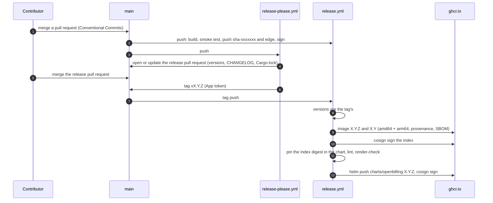
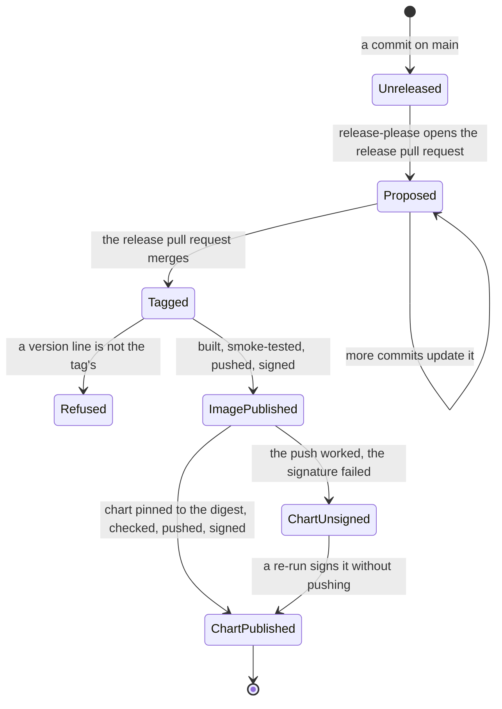

# 0005. Releases: release-please, fixed versions in production, a signed image and a chart on bjw-s common v5

Status: **Proposed** (2026-11-27). The owner's decisions quoted under *Context* stand; the judgement calls under
*Still open* are for the owner to confirm. *Amended 2026-11-27 (ANR-1329):* it has run. release-please opened the
release pull requests and v0.1.1, v0.2.0, v0.3.0 and v0.4.0 are published; the 0.3.0 image and chart pulled
anonymously (*verified 2026-11-27*). It stays Proposed until the owner accepts it.

## Summary

Versions come from the commits. **release-please** reads the Conventional Commits on `main`, keeps a release pull
request open with the next version and its changelog, and when that pull request merges it cuts a `vX.Y.Z` tag. The
tag publishes a **container image**, `ghcr.io/vaam-apps/openbilling-rs:X.Y.Z` and `:X.Y`, built for amd64 and arm64,
with its provenance and SBOM, signed with cosign keyless, and a **Helm chart**,
`oci://ghcr.io/vaam-apps/charts/openbilling` version `X.Y.Z`, signed the same way, whose default image is that
release by tag and digest. A push to `main` publishes `sha-<7>` and `edge` for development. **There is never a
`latest`**: production runs fixed versions only.

The chart is values for the **bjw-s common library 5.3.0**, the library app-template is, plus one refusal template.
The service applies its own migrations at start, so the chart has no migration Job.

## Context

The owner, 2026-11-27: "Release using CI/CD, use container images for its helm image. Use bjw v5 for building it
helm chart." (Adding the chart to a deployment is outside this repository.) And, on vaam-apps/vpay#417: "Cheat how I'm doing [here] to have
automatic commits collections for building versions ... In prod we'll deploy only fixed versions like that."

vpay already releases this way (its `release-please-config.json`, `.release-please-manifest.json`,
`.github/workflows/release-please.yml` and `release.yml` at master, *verified 2026-11-27* by reading them), and that
flow has run: its tags and signatures are recorded in its own workflow's header. Copying it gives one release
procedure across the two repositories, the same GitHub App secret names and the same action pins.

openbilling's binary is one process: `openbilling serve` connects, applies the migrations compiled into it,
prepares partitions and CrateStack's idempotency table, then serves the API, the payment provider's webhook,
`/healthz` and `/readyz`, and runs the drain. Its default listen address is `127.0.0.1:8080` until callers are
authenticated by a real issuer (ADR 0003).

## Decision

**Versions.**

1. release-please, `release-type: simple`, one package at the root, `include-v-in-tag: true`,
   `bump-minor-pre-major: true` (a `feat` before 1.0 is a minor, a breaking change is a minor too), and vpay's
   changelog sections. `bootstrap-sha` is `main` at adoption, `1cd8b10`, so the first changelog starts after it; the
   manifest seeds `0.1.0`, the version every manifest carries while unreleased.
2. Every version line carries `# x-release-please-version` and is in `extra-files`: the workspace `version` in
   `Cargo.toml` (every crate inherits it, so `openbilling --version` is the release) and the chart's `version` and
   `appVersion`. The crates depend on each other by path alone, so no dependency line moves. `Cargo.lock`, which
   cannot carry the marker, is refreshed on the release branch by `cargo metadata` and committed there, as vpay does:
   the image builds `--locked`.
3. release-please runs with a **GitHub App token** (`actions/create-github-app-token`), because what the default
   `GITHUB_TOKEN` does raises no workflow event: a tag it made would publish nothing, silently. The App is installed
   on this repository with `contents: write` and `pull-requests: write`; the secrets are vpay's names,
   `RELEASE_PLEASE_APP_CLIENT_ID` (the Client ID) and `RELEASE_PLEASE_APP_PRIVATE_KEY`. There is no fallback.
4. On a tag, `release.yml` refuses to publish when `Cargo.toml`'s version or the chart's `version` or `appVersion`
   is not the tag. `deploy/openbilling/tests/check.sh` holds the three equal on every pull request.

**Fixed versions in production.**

5. A tag `vX.Y.Z` publishes the image as `X.Y.Z` and `X.Y` and the chart as `X.Y.Z`. A push to `main` publishes the
   image as `sha-<7>` and `edge`, for development only, and no chart (an OCI chart's tag is its version: an `edge`
   chart would mean republishing one version over itself). **No `latest`, ever**: `metadata-action` is told
   `latest=false`, and the workflow refuses a `latest` tag if one appears.
6. The published chart pins the image of its own release **by tag and digest**: the release job writes the image
   index digest into the chart's `values.yaml` before packaging, renders it and refuses it unless every image carries
   a digest. In git the digest is empty (the file cannot know it) and the tag defaults to `appVersion`.
7. The chart refuses, at render time, an image tagged `latest`, and any tag that is not a fixed version
   (`X.Y.Z`, a pre-release of one, or `sha-<7>`) unless a digest fixes what is pulled.

**The image** (`docker/openbilling/Dockerfile`).

*Amended 2026-11-27: items 8 and 9 (the Debian builder and the glibc runtime) are replaced by [ADR 0006](0006-a-static-musl-binary-on-distroless-static.md): a static musl binary on distroless/static.*

8. Multi-stage with cargo-chef, so the dependencies are a layer of their own; `cargo build --release --locked` of
   `bin/openbilling` on `rust:1.98.1-slim-trixie` (the toolchain CI uses; the MSRV is 1.98).
9. The runtime is `gcr.io/distroless/cc-debian13:nonroot`: glibc, CA certificates (sqlx and reqwest read the
   platform's roots), no shell, uid 65532. Both bases are pinned by tag and digest.
10. A `smoke` stage runs `openbilling --version` and `--help` on the runtime base as the runtime user; every pull
    request builds it and pushes nothing, and the release builds it before it pushes.
11. Built for amd64 and arm64 on native runners, pushed by digest and assembled into one index; provenance
    `mode=max` and an SBOM ride in the index; the index is signed with cosign keyless. Only the jobs that sign hold
    `id-token: write`.
12. The migrations need no file at run time: they are compiled into the binary and `serve` applies them under
    sqlx's advisory lock (`Migrator::locking`, on by default, *verified 2026-11-27* in sqlx-core 0.9.0
    `src/migrate/migrator.rs`), so several replicas starting at once apply them once.
13. `serve` stops on `SIGTERM` as well as `SIGINT`. Kubernetes stops a container with `SIGTERM`, and a process that
    is PID 1 ignores a signal it has no handler for, so without this a pod would be killed at the end of its grace
    period instead of finishing its requests.

**The chart** (`deploy/openbilling`).

14. A chart of its own, `openbilling`, that depends on the bjw-s **common** library **5.3.0** and renders it with
    app-template's loader. app-template 5.3.0 is exactly that library plus one template (*verified 2026-11-27*: its
    `Chart.yaml` and `templates/common.yaml`); depending on the library directly gives the chart its own name, labels
    and top-level values, where a dependency on app-template would nest every value under `app-template:`. The
    library is pinned by version, and `check.sh` refuses an archive whose sha256 is not the one published (below).
15. Values, not templates, wherever the library can say it: the image by tag and digest, `serve`, the listen
    address, the database URL from an **existing Secret named in values** (`valueFrom.secretKeyRef`: the chart holds
    no secret), startup, liveness (`/healthz`) and readiness (`/readyz`) probes, the non-root, read-only,
    no-capability security context, a NetworkPolicy and a ServiceMonitor, both off by default. The one template is
    the refusals.
16. The pod listens on `0.0.0.0:8080`, which the Service and the probes need. Until a token verifier ships every `/v1`
    call answers `401` (ADR 0003); the NetworkPolicy decides who may connect.
17. CI checks the chart with one script, `deploy/openbilling/tests/check.sh`, runnable on a laptop: `helm lint`,
    `helm template` over defaults, everything on and a floating tag with a digest, `render-check.sh` (no Secret, no
    credential in a URL, the database URL from a Secret, every image pinned) and kubeconform (strict, with the
    ServiceMonitor schema vendored) on each render, and every refused values file refused with its message.

## Diagrams

## Consequences

- A release is a merge: nobody edits a version line. A version line without its marker, or a tag cut by hand, is
  refused at the tag.
- A deployment names a version and gets an image that cannot move under it: the chart's default is the release's
  own digest. `edge` and `sha-<7>` exist for development and a chart refuses `edge` without a digest.
- Commit messages are now release notes: a `feat` or `fix` lands in the changelog under its section.
- The first release depended on the owner: the App installed and its two secrets set. *Done:* the releases exist
  (2026-11-27). Without them `release-please.yml` fails at its first step and no tag is made; `release.yml` still
  publishes `edge` and `sha-<7>` on every push to `main`.
- GHCR makes a new package private: the image and the chart had to be made public (or a pull secret given to the
  cluster). *Done:* both pulled anonymously on 2026-11-27 (0.3.0).
- The signatures' identity is `release.yml` at the tag's ref: renaming the file changes what `cosign verify` must
  name.
- A ServiceMonitor can be switched on, but openbilling serves no `/metrics` yet: switched on today, it scrapes a 404.

## Alternatives rejected

| Alternative | Why not |
|---|---|
| A `latest` tag | Production runs fixed versions only (the owner, 2026-11-27); a floating tag is the deployment shape this rules out |
| `GITHUB_TOKEN` for release-please | Its tag raises no event, so the release would publish nothing and say nothing |
| A dependency on app-template, values under `app-template:` | The same library with every value one level down and objects named after app-template; the library directly is the documented way to build a chart of one's own on it |
| A migration Job (a Helm hook) | The binary has no command that only migrates; `serve` migrates under an advisory lock at start, so a Job would be a second process doing what the first already does safely |
| A shell or a `-debug` distroless base | Nothing in the image needs a shell; the smoke stage runs in exec form |
| An `edge` chart on every push | An OCI chart's tag is its version; it would overwrite one version or pile up pre-release versions |
| Cross-compiling arm64 under QEMU | Native arm64 runners keep the build a native one, as vpay's does |

## Still open

| Question | Recommendation |
|---|---|
| The first version: 0.1.1 or 0.2.0 from the commits, or exactly 0.1.0? | *Answered by history (2026-11-27): the first version was 0.1.1.* Let the commits decide; a `Release-As: 0.1.0` footer forces 0.1.0 if wanted |
| Should a migration ever run apart from `serve` (a Job before a rollout)? | Not until a migration is slow enough to fail the startup probe (5 minutes); then add `openbilling migrate` and a hook Job |
| Should the image and chart be public packages? | *Answered by history (2026-11-27): they are public;* an anonymous pull of the 0.3.0 image and chart answered 200. The deployment needs no pull secret |
| The listen address: `0.0.0.0:8080` in the chart while every `/v1` call is refused | Keep it, with the NetworkPolicy on in a deployment; revisit when the token verifier ships |
| The ServiceMonitor before `/metrics` exists | Keep it off and documented; the metrics endpoint is its own slice |
| Newer majors of the pinned actions exist (for example `docker/build-push-action` v7) | Keep vpay's pins so the two repositories move together; dependabot proposes the updates |

## Agent notes

| Pin | Value | Source, *verified 2026-11-27* |
|---|---|---|
| bjw-s common | `5.3.0`, the newest of the 5.x line (tags `common-5.0.0` … `common-5.3.0`); OCI manifest `sha256:d1738ab79720d0369126df92adf6bbf32c20ea816edc4ab5cd377b2beba8f408`, archive `sha256:d373034b8f8d2d7c25d4028f8280a2112486a8b1a3deb1f4e690cd132ac20f80` | `git ls-remote --tags https://github.com/bjw-s-labs/helm-charts`; `helm pull oci://ghcr.io/bjw-s-labs/helm/common --version 5.3.0`; `https://bjw-s-labs.github.io/helm-charts/index.yaml` (the same archive digest) |
| bjw-s app-template | `5.3.0` (not a dependency; read to confirm it is common 5.3.0 and one template); OCI manifest `sha256:0e13b145656490310ada364d8eb708e5f4f6384c7deb60d3f5f0fa56950ff63a` | `helm pull oci://ghcr.io/bjw-s-labs/helm/app-template --version 5.3.0` |
| `rust:1.98.1-slim-trixie` (superseded by ADR 0006: `rust:1.98.1-alpine3.24`, index `sha256:7cc1c22d77d9432f7fe012a70e6d3e555af54c2a6832700ed7d553f1769ae89f`) | index `sha256:4cd829461bd5c4d511c32e269da9cb8929223b666519d8004e35fc8d1d771ab7` | `hub.docker.com/v2/repositories/library/rust/tags/1.98.1-slim-trixie` (the registry itself rate-limited the request) |
| `gcr.io/distroless/cc-debian13:nonroot` (superseded by ADR 0006: `static-debian12:nonroot`, index `sha256:afa5c872c891853ca7fcf1f12c3edb23f7eeef36189728842dd51042ff57f7ab`) | index `sha256:29ee70762214fe8190cea04ef1c0a84a8365879e047ce8f911ae5a5ab2355fa2` (amd64, arm64 among its platforms) | the manifest answer of `gcr.io/v2/distroless/cc-debian13/manifests/nonroot` |
| cargo-chef | `0.1.78` (2026-08-12), with `cook --package` | crates.io; its `src/main.rs` |
| Helm | `v4.3.2` (CI and the local checks) | `get.helm.sh`, sha256 matched |
| kubeconform | `v0.8.0`, linux-amd64 archive `sha256:9bc2bffbf71f261128533edaf912153948b7ff238f9a531ae6d34466ec287883` | its release's `CHECKSUMS` |
| ServiceMonitor schema | `deploy/openbilling/tests/schemas/monitoring.coreos.com/servicemonitor_v1.json`, `sha256:78062f4c2364bf6056a8df40cfb7039936f836014aff2078c0c598dfce69c51e` | datreeio/CRDs-catalog at `b50f3fbc45169a14b6d2d3f767b32fd96ef4a3fa` |
| Actions | vpay's pins, each SHA the tag's commit | `git ls-remote` of each action's repository |
