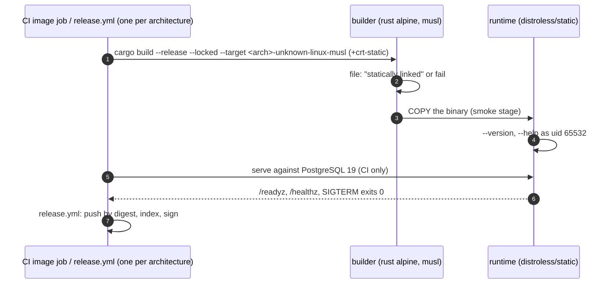
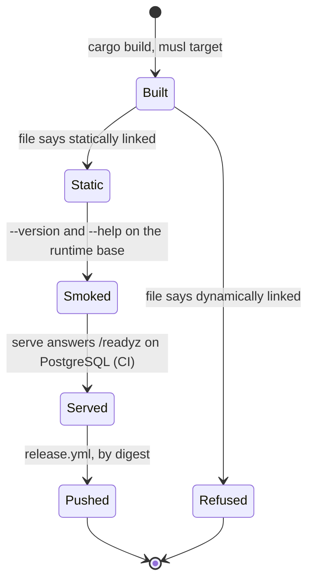

# 0006. A static musl binary on distroless/static

Status: **Proposed** (2026-11-27). The owner's decision quoted under *Context* stands. Nothing here has run in CI yet:
the image was not built where this was written (no usable build environment), so the first evidence is the pull
request's two `image` jobs, amd64 and arm64, which also run `serve` from the image against PostgreSQL.

## Summary

The image is the service binary built for `x86_64-unknown-linux-musl` or `aarch64-unknown-linux-musl`, statically
linked, copied onto `gcr.io/distroless/static-debian12:nonroot`. The build fails if the binary is not static. The
chart does not change. This amends the image decisions of [ADR 0005](0005-release-fixed-versions-image-and-chart.md)
(items 8 and 9); the rest of that ADR stands.

## Context

The owner, 2026-11-27 (decision row 220, ANR-1172): "openbilling-rs should be a static binary at the end ... So that we
can simply copy them into a distroless base container". The image was cargo-chef on Debian, then
`distroless/cc-debian13`, which carries glibc.

What the binary links, found with `cargo tree --locked -p openbilling` and `Cargo.lock` on 2026-11-27, for
`x86_64-unknown-linux-musl` and `aarch64-unknown-linux-musl`:

| Dependency | What it is | On musl |
|---|---|---|
| `openssl`, `openssl-sys`, `native-tls`, `aws-lc-rs`, `aws-lc-sys`, `mimalloc` | absent | n/a |
| `ring` 0.17.14 | the TLS provider (rustls, through sqlx and reqwest) and the signature checks of `openbilling-jwt`; C and assembly, built by `cc` | builds with a C compiler for the target; **the one C dependency** |
| `webpki-roots` 1.0.12 | sqlx's trust roots for the PostgreSQL connection, compiled in (sqlx feature `tls-rustls-ring-webpki`) | pure Rust data; reads nothing from the image |
| `rustls-platform-verifier` 0.7.1, `rustls-native-certs` 0.8.5, `openssl-probe` 0.2.2 | reqwest 0.13 (CrateStack's client, the vpay adapter and the JWKS fetch of `openbilling-jwt`) reads the platform's trust roots | pure Rust; reads `/etc/ssl/certs/ca-certificates.crt` (or `SSL_CERT_FILE`) at run time |
| `libsqlite3-sys` | in `Cargo.lock` only: not in the dependency graph of the binary (`cargo tree -i` finds nothing) | not built |

So TLS needs no system library at build time, and the only file read at run time is the CA bundle, by reqwest alone.
sqlx's connection to PostgreSQL does not read `/etc/ssl`. The pinned `static-debian12:nonroot` image holds that bundle
(*verified 2026-11-27*: the amd64 layers, pulled anonymously, hold `/etc/ssl/certs/ca-certificates.crt`, `/etc/passwd`,
`/etc/nsswitch.conf` and `usr/share/zoneinfo/UTC`; its config sets `SSL_CERT_FILE` and `User 65532`).

## Decision

1. **Musl, one target per architecture.** `release.yml` already builds each architecture on a native runner. The
   Dockerfile's builder is `rust:1.98.1-alpine3.24`, whose toolchain is musl-native, and passes `--target` explicitly
   (`x86_64-unknown-linux-musl` on amd64, `aarch64-unknown-linux-musl` on arm64) with
   `RUSTFLAGS=-C target-feature=+crt-static`. With `--target`, the flag does not reach build scripts and proc-macros,
   which must stay dynamic. CI's `image` job now builds both architectures on pull requests, as the release does.
2. **A static runtime.** `gcr.io/distroless/static-debian12:nonroot`, pinned by tag and digest
   (`sha256:afa5c872c891853ca7fcf1f12c3edb23f7eeef36189728842dd51042ff57f7ab`, the index digest, read anonymously from
   gcr.io on 2026-11-27). Still no shell, uid 65532. The owner named Debian 12; the previous runtime was Debian 13.
3. **Static is a build step.** After the build, `file` must say "statically linked" or "static-pie linked" and not
   "dynamically linked", or the Dockerfile fails. (glibc's `ldd` would say "not a dynamic executable"; Alpine's `ldd`
   is musl's and does not, so `file` is the check.) The smoke test, `--version` and `--help` on the runtime base as
   uid 65532, stays: a binary that needed a library would fail there too. CI's `image` job then runs `serve` from
   the loaded image against PostgreSQL 19, waits for `/readyz`, reads `/healthz`, and stops it with `SIGTERM`, which must
   exit 0: the end-to-end suite runs the glibc host build, so this is the one run of the musl binary against a database.
4. **The allocator stays musl's for now.** The service has no allocator dependency. The card asks to measure the
   drain loop's throughput under musl's malloc against mimalloc and to keep mimalloc only if the gap is real. There
   is no mimalloc to keep, and no drain loop worth measuring yet (the skeleton does not serve a load): **not
   measured**. Adding `mimalloc` would add a second C dependency to a build that has one; it waits for a measurement,
   which belongs with the first load test.
5. **The chart is unchanged.** The image keeps its entry point, user and port.

## Evidence

- On 2026-11-27 `cargo +1.98.1 build --release --locked --target x86_64-unknown-linux-musl -p openbilling` (Rust
  1.98.1, glibc `gcc` as the C compiler for `ring`) finished in 2m29s; `file` said "ELF 64-bit LSB pie executable,
  x86-64, statically linked (static-pie)", `ldd` said "statically linked", and `openbilling --version` and
  `serve --help` ran. The binary was 15.7 MB, not stripped.
- Not run: the Docker build (on this machine the registry's TLS did not verify and the disk was full), the arm64 build,
  the image's size against the old image's, and a run against PostgreSQL. CI's `image` jobs are the proof.

## Diagrams

## Consequences

- No libc in the image: no `getaddrinfo` from glibc (musl's resolver is used; it has no `nsswitch`, so only `/etc/hosts`
  and DNS), which suits a pod. Anything later that needs a C library must be static or leave this image.
- `ring` is still C: the Alpine builder carries the compiler, and the build fails loudly without it.
- `docs/adr/0005` items 8 and 9 are amended by a dated note pointing here.

## Alternatives rejected

- **Cross-building from glibc** (cargo-zigbuild or a musl cross toolchain on one runner): one builder for both
  architectures, but a toolchain the release then depends on, and `ring`'s C compiled by a cross compiler. Native
  Alpine builders per architecture are what `release.yml` already shaped.
- **A Chainguard static base**: a comparable image, but not the owner's named base (`distroless/static`) and a second
  registry and trust root to pin.
- **`scratch`**: no CA bundle, no `/etc/passwd` (the non-root user), no `nsswitch.conf`, no timezone data; each would be
  copied in by hand. distroless/static is exactly those files.

## Still open

- **The allocator.** Musl's malloc against mimalloc under the drain loop's load, measured on the first load test; a
  second C dependency only if the gap is real.
- **Debian 12 or 13.** `static-debian13` also exists; the owner named `static-debian12`. The static image carries no
  libc, so the release only changes its data files. Moving is one digest, with the tag, in the Dockerfile.
