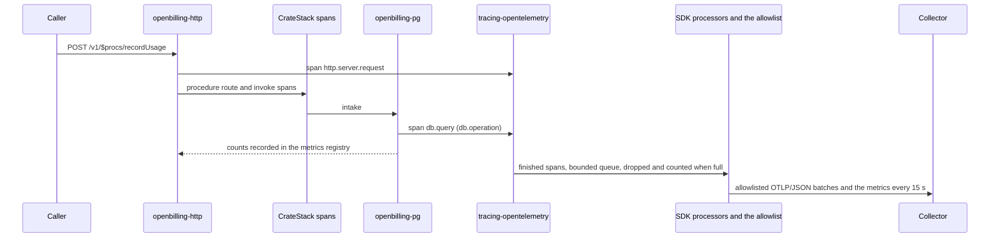
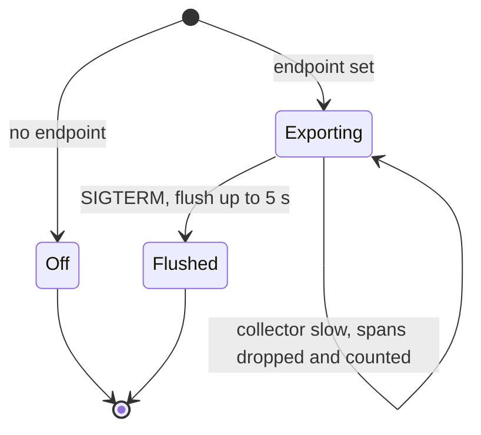

# 0007. OpenTelemetry through the OpenTelemetry SDK over CrateStack's spans, and dashboards as code

Status: **Accepted** (2026-11-27). The first version (PR #22) hand-wrote the OTLP exporter and left that choice to the
owner; the owner chose the SDK the same day (*Amended 2026-11-27*, below). The dashboards are generated by Python
scripts (*Amended 2026-11-27*). Verified by tests (a collector in the process, a PostgreSQL 19 in CI); not yet run
against a real collector or a real Grafana.

**Amended 2026-11-27 (ANR-1201).** The owner decided: *"We'll use opentelemetry libs and json dashboards built with
python scripts."* The hand-written OTLP encoder and exporter of the first version are gone: the service now exports
through `opentelemetry`, `opentelemetry_sdk`, `opentelemetry-otlp` and `tracing-opentelemetry`, and the dashboards are
JSON written by `tools/dashboards/*.py`. The guarantees of the first version (the allowlist, closed labels, no ids or
amounts, strict `OTEL_*`, off unless an endpoint is set, bounded queues, a flush on exit, the exporter's own drop and
failure metrics, the byte-scan sentinel tests) are kept, and the tests that hold them are the same tests. What changed
is under *Decision*, *Dependencies* and *Alternatives rejected*; the questions that this decision answers are struck
out under *Still open*.

## Summary

The service exports traces, metrics and logs through the OpenTelemetry SDK over OTLP/HTTP with JSON bodies, **off
unless an endpoint is set**. CrateStack `=0.20.6` has **no OpenTelemetry exporter**: it emits `tracing` spans, and this
decision exports them. A small crate, `openbilling-telemetry`, wires `tracing-opentelemetry` to the SDK and holds what is
ours: an allowlist that cleans every span at the exporter, a log layer, the bridge from a registry of closed metrics to
the SDK's instruments, and bounded queues that count what they drop. **Nothing that identifies a person, an account or
an amount can be an attribute or a label**; that is held by construction and by a test. Two Grafana dashboards ship as
JSON in `deploy/dashboards/`, generated by Python scripts in `tools/dashboards/` (CI fails if the files drift from
them), each panel explained, and the chart can ship them as a ConfigMap.

## Context

The owner, 2026-11-27 (decision row 219): *"Cratestack support OTel exporters. We need to use that. More generally,
all backends should export OTel and we need to build OTel dashboards, important information to watch."*
Dashboards for a Grafana or an OpenObserve instance for operators, separate from any instance for users.

The owner, 2026-11-27, on the first version's open question (hand-rolled exporter or the SDK): *"We'll use opentelemetry
libs and json dashboards built with python scripts."*

**What CrateStack gives** (*verified 2026-11-27*, the `=0.20.6` sources in the cargo registry and crates.io):

| Claim | Source |
|---|---|
| CrateStack emits `tracing` spans from generated code: `cratestack_procedure_route`, `cratestack_procedure_invoke_with_db`, `cratestack_model_list_route`, with `cratestack_*` fields | `cratestack-macros-0.20.6/src/axum/procedure.rs`, `procedure/instrument.rs`, `axum/model/handlers_list.rs` |
| It emits events on `target: "cratestack"` with `cratestack_error` when a procedure fails | same files |
| `cratestack-service` has `telemetry::init`, a `tracing_subscriber` fmt (text or JSON) bootstrap, and no OpenTelemetry | `cratestack-service-0.20.6/src/telemetry.rs`, its `Cargo.toml` (no opentelemetry dependency) |
| No `cratestack-*` crate on crates.io is an OpenTelemetry exporter | crates.io search for `cratestack`, 2026-11-27, 41 `cratestack*` crates, none |

**The owner's premise, "CrateStack supports OTel exporters", is wrong at `=0.20.6`.** CrateStack emits `tracing`
spans, which an exporter can read, and ships no exporter: its own `telemetry.rs` is a text or JSON log formatter, and
no crate of the 41 `cratestack*` crates on crates.io is one (checked 2026-11-27). The decision is to export what
CrateStack emits, rather than wait for an exporter that nothing announces.

Constraints: the binary stays static with no OpenSSL and no C code ([ADR 0006](0006-a-static-musl-binary-on-distroless-static.md));
the repository is public; `cargo deny` stays green; **no secret, token or person's id in a signal**. Account, owner
and member ids are opaque to the service, but they are the customers' and an operations instance is not where they
belong.

## Diagrams

## Decision

1. **The SDK, behind a seam.** Spans go through `tracing-opentelemetry`, which turns `tracing` spans into
   OpenTelemetry spans, to the SDK's batch processor and its OTLP exporter. Metrics and logs go to the SDK's meter and
   logger providers. The registry of metrics stays its own dependency-free crate, `openbilling-metrics`, so the crates
   that record (`openbilling-pg`, `openbilling-http`) depend on no exporter (Rule 4): the registry offers one seam, a
   `Recorder` that `openbilling-telemetry` attaches, which receives each counter increment and histogram
   observation, and the gauges are read by observable instruments when the SDK collects. Names, units and
   descriptions stay the registry's, so the SDK does not rename a metric and the dashboards' queries are unchanged.
2. **One transport, caller-supplied.** OTLP over HTTP with JSON bodies (`opentelemetry-otlp`, feature `http-json`),
   through one blocking `reqwest` client that this crate builds (the workspace's `reqwest` on rustls with ring, no
   redirect, the timeout, and the CA bundle of `OTEL_EXPORTER_OTLP_CERTIFICATE` as the only trust). The SDK's batch
   processors and its periodic reader run on threads of their own, so the blocking client is the right one and
   recording never waits on the network. No `tonic`, no gRPC, no `aws-lc-rs`, no OpenSSL, and no HTTP client of the
   SDK's own.
3. **An allowlist of field names, held at the exit** (`filter::FIELDS`). `tracing-opentelemetry` records every field of
   a span; the span exporter is wrapped, and each finished span is cleaned before the OTLP exporter sees it: only
   allowlisted names stay, a text value is held to a plain alphabet and 64 bytes, span events and links never leave
   (CrateStack's `cratestack_error` event becomes the span's `error.type` and error status), the span's kind is set from
   its name and its status carries no message. Logs are filtered where they are made, by a small layer of ours (the
   same allowlist; a message held to words of letters). `Debug` values are never read. An inbound `traceparent` is
   never extracted.
4. **Metrics are closed.** Counters add counts, histograms record durations, gauges hold counts and ages; a label is
   two `&'static str`. No amount and no id can be recorded. The list is in the crate README; the dashboards are held
   to it by a test.
5. **Bounded, counting queues.** Spans and logs wait in a queue of 4096 (the SDK's batch processors behind a counter of
   our own: a full queue drops the new item and counts it in `openbilling.telemetry.dropped`), and every export
   request is counted by result in `openbilling.telemetry.exports` by the wrapper around each SDK exporter. The SDK's
   own retry applies to a failed request; a request that still fails is dropped and counted, and one rate-limited line
   goes to stderr.
6. **Off unless an endpoint is set**, configured by the standard `OTEL_*` variables, a subset read strictly by
   `Settings`: a variable of the specification this exporter does not honour (per-signal headers, client
   certificates, the batch limits, a sampler it does not know) stops `serve` at start rather than being ignored.
   Every value is passed to the SDK explicitly, so the SDK reads no variable of its own that the settings did not
   (its resource has no detectors). Headers come from a file, never an environment variable; a protocol other than
   `http/json` is refused. **The variables, not an `otel` block of `OPENBILLING_CONFIG` (ADR 0001, amended, F1 to F4):**
   that file holds the deployer's policy, and the environment holds endpoints and secrets; an endpoint and a credential
   header belong to the second, and no setting is read from both.
7. **Spans:** one `http.server.request` per request (the probes are metrics only), CrateStack's three route and
   procedure spans as its children, one `db.query` span per ledger operation, `drain.cycle` and `partitions.run`
   for the loops. **Metrics:** events at intake and decided by the drain by result and reason, ledger postings by
   kind, `getAllowed` verdicts by check and mode, errors by class and source, request and database durations, the drain's
   duration and lag, the queue's backlog and oldest age, and the pool. **Logs:** `INFO`-and-above events of this
   repository, whose messages are held to words of letters (anything else is exported as `redacted`).
8. **Dashboards are Grafana JSON generated by Python scripts** (`tools/dashboards/`, standard library only: `lib.py`
   holds the builders, `service.py` and `queue_dashboard.py` hold the panels (not `queue.py`, which would shadow the standard library's `queue`)). The scripts write `deploy/dashboards/` and the
   chart's copy in `deploy/openbilling/dashboards/`; a CI job runs `tools/dashboards/generate.sh` and fails on any
   difference, so the JSON is never edited by hand. Grafana reads a Prometheus-compatible store, which an OpenObserve
   instance also offers over PromQL. A test holds each panel's metrics and labels to the service's own list.

## Dependencies

*Verified 2026-11-27*, crates.io and each crate's own `Cargo.toml` in the registry (versions are the latest published
that day):

| Crate | Version | Features | Why this version |
|---|---|---|---|
| `opentelemetry` | 0.33.1 | `trace`, `metrics`, `logs` | The API; `tracing-opentelemetry` 0.34.0 requires `opentelemetry` 0.33 |
| `opentelemetry_sdk` | 0.33.1 | `trace`, `metrics`, `logs` (dev: `testing`, for the in-memory exporters) | The same 0.33 line; none of `rt-tokio`, `experimental_*` or `internal-logs` |
| `opentelemetry-otlp` | 0.33.1 | `http-json`, `reqwest-blocking-client`, `trace`, `metrics`, `logs` | `http-json` is `serde_json`, `prost`, `opentelemetry-http` and `opentelemetry-proto/{gen-tonic-messages, with-serde}`; **`gen-tonic-messages` is only the message types, not `tonic`** |
| `tracing-opentelemetry` | 0.34.0 | none (`default-features = false`) | The bridge from `tracing` spans |

`opentelemetry-http` 0.33.1 depends on `reqwest` `0.13.1` with default features off, so it adds no TLS stack: with the
workspace's `reqwest` 0.13.5 (`rustls-no-provider`, ring) there is one `reqwest` in the tree. (The card named
`reqwest` 0.12; the workspace and the SDK are on 0.13, and 0.12 would be a second copy.) Its `reqwest-blocking` feature
implements `HttpClient` for `reqwest::blocking::Client`, and uses the timeout configured on the supplied client.

**Static check (ADR 0006).** `cargo tree -p openbilling --target {x86_64,aarch64}-unknown-linux-musl -e normal,build`
before and after, 2026-11-27: the same set on both targets. **Added:** `opentelemetry`, `opentelemetry-http`,
`opentelemetry-otlp`, `opentelemetry-proto`, `opentelemetry_sdk`, `tracing-opentelemetry` (all Apache-2.0 or MIT),
`prost` and `prost-derive` (Apache-2.0), `rand` 0.9, `rand_chacha`, `rand_core`, `getrandom` 0.3, `ppv-lite86` and
`zerocopy` (MIT or Apache-2.0), `futures-executor` and `futures-macro`, `const-hex` and `itertools`. **No `-sys` crate,
no `aws-lc-rs`, no OpenSSL or `native-tls`, no `tonic`, no `cmake`, and no C compilation beyond what the tree had
(`ring`, which is the only C).** Removed: none. `tracing-subscriber` stays with `registry` and `std`. The dev-only
`testing` feature of the SDK adds `proptest` and friends to the test build only (not in `-e normal,build` of the
binary). Every added licence is on `deny.toml`'s allow list; `cargo deny check` runs in CI (the `deny` job).

## Alternatives rejected

| Alternative | Why not |
|---|---|
| **The hand-written OTLP/JSON exporter of the first version** (about 250 lines of ours: the three request documents, a batcher, a retry loop, `reqwest`) | Rejected by the owner, 2026-11-27, in favour of the standard libraries. The reasons that carry: it is code of ours to keep in step with OTLP (resource and scope fields, the metric data model, the aggregation temporality, retry-after handling) where the SDK keeps it; the owner's convention for every new backend is these crates, so one stack means one set of behaviours and one thing to learn; and the objection that made it attractive, that the SDK might bring `tonic`, `aws-lc-rs` or an HTTP client of its own, does not hold: `http-json` is only message types, and a caller-supplied client keeps one `reqwest` on ring (*Dependencies*). The costs that remain are real and small: six more crates and `prost` in the tree, and an allowlist that now sits at the exporter instead of at the point of recording, which `filter::clean` and its tests hold |
| The SDK's own `reqwest-rustls` / default features | `opentelemetry-otlp`'s default features add `reqwest-blocking-client` over its own client builder and `http-proto`; `opentelemetry-http`'s `reqwest-rustls` enables `reqwest/rustls`, which is aws-lc-rs (*verified 2026-11-27*, `reqwest-0.13.5/Cargo.toml`). The client is supplied, built as the workspace's is |
| `opentelemetry-appender-tracing` for logs | It reads every field of every event, `Debug` values included; the allowlist and the message rule must hold before a record is made, so a layer of ours (`layer::LogLayer`, about 80 lines) creates the records through the SDK's logger |
| The SDK's `tonic` / gRPC transport, `http-proto` | gRPC needs `tonic` (hyper, h2, tower: a second HTTP stack) for nothing the collector needs. `http-proto` is a fine alternative to `http-json` (smaller bodies) and changes one feature and one protocol value; JSON keeps the test collector and the sentinel scans readable, and the bodies are small |
| Wait for CrateStack to ship an exporter | None is announced; the owner wants dashboards now. The layer reads the spans CrateStack emits, so an exporter of CrateStack's would replace only the span half of `export.rs` |
| `cratestack_service::telemetry::init` | It formats to stdout; it does not export, and it pulls `env-filter` (regex) |
| Prometheus scrape (`/metrics`) | A pull endpoint on the public listener, or a second one to firewall. Push over OTLP matches the owner's decision and needs no Service or ServiceMonitor |
| Account ids as attributes "for debugging" | A support need is met by the ledger, not by a trace store of the operator's. The cost of one leaked id in a vendor's store is not reversible |
| Dashboards written by hand, or by a Grafana library (`grafonnet`, `grafanalib`) | By hand drifts from the metrics and from the chart's copy; a library is a dependency (Jsonnet, or a Python package) to justify for two files. A standard-library Python script is the owner's choice, and `generate.sh` plus a CI diff is the whole toolchain |

## Consequences

- A deployment sets one variable (`openbilling.otel.endpoint` in the chart) to turn everything on, and gets golden
  signals, the queue and the database.
- The exporter drops, never blocks: queues are bounded (4096), the SDK retries a failed request and then drops it,
  and both are counted (`openbilling.telemetry.dropped`, `.exports`) and shown on the dashboard. A collector that is
  down costs telemetry, not requests. The SDK exports from threads of its own (a blocking client), so `serve` starts
  the exporter on a thread and `Guard::shutdown` flushes on another, with a deadline.
- Metrics are cumulative and in the process: a restart resets counters (a Prometheus-compatible store handles it).
  With several replicas each exports its own series and the dashboards aggregate them: counters and pool gauges
  with `sum`, and the queue's backlog, age and the drain's lag with `max`, because every replica reads the same
  table.
- A new span field or metric label is a code change in two places (the field and `FIELDS`, or the instrument
  enum), and the dashboards test fails if a panel queries a name that is gone. A new panel is a line in
  `tools/dashboards/`, and `generate.sh` rewrites both copies.
- Counts recorded before telemetry starts are not exported: the `Recorder` sees increments after `attach` only, so `serve` starts telemetry first and anything counted earlier stays in the in-process registry alone.
- The SDK and the bridge move together (`opentelemetry*` 0.33, `tracing-opentelemetry` 0.34): one change in
  `Cargo.toml`, with `cargo tree` on both musl targets as the check.

## Still open

| Question | Notes |
|---|---|
| ~~Hand-rolled exporter, or the OpenTelemetry SDK?~~ | **Answered by the owner, 2026-11-27: the SDK** (*Amended*, above) |
| Does the deployment's collector and store apply the OpenTelemetry to Prometheus name translation the dashboards assume? | *Unverified.* The names follow the specification; the SDK exports the names the registry gives, unchanged; a different scheme needs the queries adjusted (`tools/dashboards/`) |
| Counters with no data point | *Unverified against a store.* A counter or histogram that was never recorded is expected to have no series (the SDK reports a synchronous instrument's data points only once it has recorded them); a panel over one would show no data, not zero, until the first event |
| An OpenObserve-native dashboard format | Grafana JSON was chosen once for the family. OpenObserve imports its own format; a second generator in `tools/dashboards/` is the follow-up if the operators' instance is OpenObserve alone |
| Alert rules | None shipped: the thresholds in the dashboards' README are starting points for the operator |
| `traceparent` propagation to the payment provider | Not done; the vpay adapter does not forward a trace context |
| `http-proto` instead of `http-json` | One feature and one protocol value; smaller bodies. Not needed yet |

