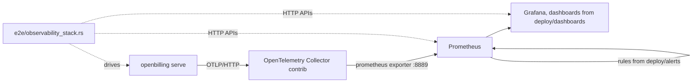

# The observability stack, locally and in CI

`sh tools/observability/run.sh` runs the whole path the dashboards and the alert rules depend on, with real
binaries and no container runtime:



It then runs the gated scenario [`e2e/observability_stack.rs`](../../e2e/observability_stack.rs), which asks
Prometheus and Grafana what the dashboards and the alert rules ask (what it checks is in
[`e2e/README.md`](../../e2e/README.md)). Everything binds `127.0.0.1`; Grafana gets a random admin password for the run.

## Run it

Needs `python3`, `curl`, `tar`, `cargo` and a PostgreSQL 19 whose user may create databases:

```sh
export OPENBILLING_TEST_DATABASE_URL=postgres://postgres@127.0.0.1:5432/postgres
sh tools/observability/run.sh
```

The first run fetches about 700 MB (Grafana's tarball is 485 MB) into `OBS_CACHE` (default
`~/.cache/openbilling-observability`); later runs reuse it. Ports are `OBS_OTLP_PORT` 4318, `OBS_EXPORTER_PORT` 8889,
`OBS_PROMETHEUS_PORT` 9090 and `OBS_GRAFANA_PORT` 3000: set others when those are taken. On a failure the script prints
the tail of each component's log. `.github/workflows/observability.yml` runs this same script.

## The pins

[`versions.env`](versions.env) holds every pin, read from the registries on 2026-11-28 (*verified 2026-11-28*):

| Component | Pin | Source |
|---|---|---|
| OpenTelemetry Collector contrib | `otel/opentelemetry-collector-contrib` 0.142.0, `sha256:38c349c3b7a2fd7ea46700cde8fa13d35b699ef2ce245bdf34dae2a413512f76` | Docker Hub, the multi-platform index |
| Prometheus and promtool | `prom/prometheus` v3.16.0, `sha256:e04987641b57704f408e31f6373ba4138ecf27cb4a165d24aabb6c38fddd0f06` | Docker Hub, the multi-platform index |
| Grafana | 13.3.1 linux-amd64, `sha256:6acf8939dd2f73332cbcafc27a33973fb1115b8867e7ffa3223c6e2ecbed8531` | `dl.grafana.com/oss/release/` (the sha256 its `.sha256` file lists) |

[`fetch.py`](fetch.py) (standard library) reads the registry's v2 API: the index must hash to the pinned digest, then
the linux/amd64 manifest and each layer are checked by sha256, and only the named files are extracted (`tarfile`
filter `data`). Move a pin by reading the new digest from the registry, editing `versions.env` and marking it
*verified* with the date. promtool, used by CI's dashboards job, comes from the same Prometheus pin.

## Files

| File | What |
|---|---|
| `run.sh` | Fetch, start in order (Collector, Prometheus, Grafana) with readiness polls, run the test, stop everything and print logs on failure |
| `otelcol.yaml` | OTLP/HTTP in, the `prometheus` exporter out (`add_metric_suffixes: true`); traces and logs to `debug` |
| `prometheus.yaml` | Scrape the exporter every 2 s with `honor_labels: true`, load `deploy/alerts/openbilling.rules.yaml` |
| `grafana/provisioning/` | The Prometheus data source (uid `prometheus`, `timeInterval: 2s`) and a file provider on `deploy/dashboards`, unmodified |

## What it does not cover

The Prometheus native OTLP receiver, OpenObserve, Mimir and VictoriaMetrics; alert delivery (no Alertmanager runs); a
threshold crossed on a live service (that is `promtool test rules`); and Grafana's rendering in a browser. See ADR 0007,
*Still open*.
